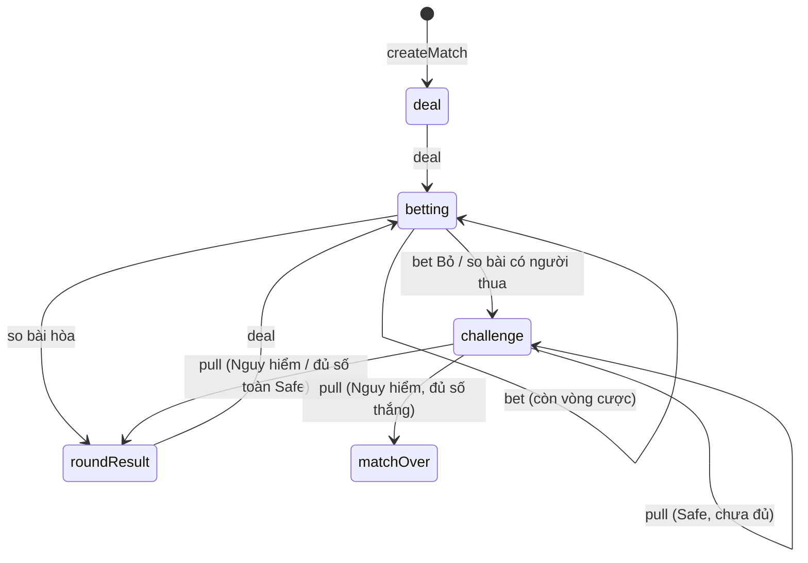

# Lõi luật chơi (src/core)

Lõi là TypeScript thuần, chạy được trên Node, để sau này chuyển lên server. Scene chỉ gửi hành động vào và diễn lại sự kiện trả ra.

**Thứ tự ưu tiên khi mâu thuẫn:** `docs/plan.md` (bảng quyết định) > `the-last-lever-thiet-ke.md` > skill này. Nếu luật đổi, sửa cả skill này.

**Skill liên quan:** `poker-engine` (bài, xếp hạng, cược), `lever-challenge` (cần gạt), `bot-ai`, `testing-vitest`.

## Quy tắc bắt buộc

1. **Không import** `phaser`, `scenes/`, `ui/`, `i18n/` (ESLint chặn). Lõi không biết chuỗi hiển thị: chỉ trả mã (`'fold'`, `'danger'`...), lớp hiển thị dịch qua `t()`.
2. **Hàm thuần:** `applyAction(state, action)` trả `{ state, events }`, không sửa `state` đầu vào. Dùng spread/copy, không `push` vào mảng của state cũ.
3. **Không `Math.random`, không `Date.now`.** Mọi số ngẫu nhiên đi qua `rng.ts`, trạng thái RNG nằm trong `GameState`.
4. **State là dữ liệu thuần** (object, mảng, số, chuỗi, boolean): `structuredClone` và `JSON.stringify` được. Không class, không Map/Set, không hàm trong state.
5. **Không gõ cứng con số.** Đọc từ `src/config.ts` (`BETTING`, `LEVERS`, `MATCH_MODES`). Thiếu tham số thì thêm vào `config.ts`.
6. **Hai ghế, không phân biệt người và bot.** Lõi dùng `Seat = 0 | 1`. Ghế nào là người, ghế nào là bot là việc của scene hoặc script, nhờ vậy `scripts/sim.ts` cho hai bot tự đấu được.

## Bản đồ tệp

| Tệp | Nội dung |
| --- | --- |
| `rng.ts` | PRNG mulberry32 có hạt giống: `next`, `int`, `pick`, `shuffle`, lấy và khôi phục `state` |
| `cards.ts`, `handEvaluator.ts`, `betting.ts` | Xem skill `poker-engine` |
| `levers.ts` | Xem skill `lever-challenge` |
| `match.ts` | Chế độ, tỉ số, số ván hòa, `isMatchOver`, `matchWinner` |
| `gameState.ts` | Kiểu `GameState`, `Action`, `GameEvent`, `PlayerView`, `Seat` |
| `rules.ts` | `createMatch`, `applyAction`, `availableActions`, `currentActor`, `viewFor` |
| `errors.ts` | `IllegalActionError` |

Test của lõi nằm ở `tests/core/`, helper dùng chung ở `tests/testing.ts` (xem skill `testing-vitest`).

## rng.ts

```ts
// mulberry32: tiny, fast, and its whole state is one 32-bit integer, so it fits in GameState.
export class Rng {
  constructor(private s: number) {}
  get state(): number {
    return this.s;
  }
  next(): number {
    this.s = (this.s + 0x6d2b79f5) | 0;
    let t = Math.imul(this.s ^ (this.s >>> 15), 1 | this.s);
    t = (t + Math.imul(t ^ (t >>> 7), 61 | t)) ^ t;
    return ((t ^ (t >>> 14)) >>> 0) / 4294967296;
  }
  int(n: number): number {
    return Math.floor(this.next() * n); // 0..n-1
  }
  // range(min, max) (gồm cả hai đầu), pick(arr), shuffle(arr) (Fisher-Yates từ cuối mảng, trả mảng mới)
}
```

Trong `applyAction`: tạo `new Rng(state.rngState)`, dùng nó, rồi ghi `rng.state` vào state mới. Bên ngoài vẫn thấy hàm thuần.

**Thứ tự rút số ngẫu nhiên là một phần hợp đồng.** Đổi thứ tự (ví dụ xáo bài trước rồi mới chọn người đi trước) sẽ làm mọi hạt giống ra chuỗi sự kiện khác. Muốn đổi thì cố ý đổi và cập nhật snapshot test. Thứ tự hiện tại:

1. Khi `deal`: chọn người đi trước, rồi xáo bộ bài, chia 2 lá cho ghế 0, 2 lá cho ghế 1, rồi 5 lá chung.
2. Khi vào `challenge`: số cần Nguy hiểm, rồi vị trí các cần.

## Phase và hành động



```ts
export type Seat = 0 | 1;
export type Phase = 'deal' | 'betting' | 'challenge' | 'roundResult' | 'matchOver';
export type BetMove = 'check' | 'raise' | 'call' | 'fold' | 'allIn';

export type Action =
  | { type: 'deal' } // phase deal hoặc roundResult
  | { type: 'bet'; seat: Seat; move: BetMove } // phase betting, đúng lượt
  | { type: 'pull'; seat: Seat; lever: number }; // phase challenge, chỉ người thua poker
```

- **Hành động không hợp lệ thì `throw`** (class `IllegalActionError`), không trả state cũ. Scene, script và bot chỉ gửi hành động lấy từ `availableActions(state)` (hoặc `view.legal`), nên throw là dấu hiệu lỗi lập trình.
- `currentActor(state)` trả ghế phải hành động (`betting`: `toAct`, `challenge`: `loser`), hoặc `null` khi bước tiếp theo là `deal` hay trận đã xong.
- `deal` gộp việc dọn ván cũ, chia ván mới và bắt đầu vòng trước flop. Không có hành động "nextRound" riêng.
- Một hành động có thể kéo theo nhiều bước tự động. Ví dụ Theo ở river dẫn tới so bài rồi vào `challenge`; Tất tay được Theo dẫn tới lật hết lá chung rồi so bài. Tất cả nằm trong cùng một `events`.

## GameState gợi ý

Có thể chỉnh tên trường, nhưng giữ các ý sau: bài chung chia sẵn 5 lá và chỉ lộ theo `revealed`; trạng thái ẩn của cần nằm trong state, không bao giờ lọt vào `PlayerView`.

```ts
export interface GameState {
  phase: Phase;
  mode: MatchMode; // 'bo3' | 'bo5' | 'bo7'
  rngState: number;
  round: number; // 1, 2, 3...
  wins: [number, number];
  draws: number; // gộp hòa poker và hòa toàn Safe (quyết định #13)
  firstActor: Seat; // ngẫu nhiên mỗi ván, mở lời cả 4 vòng (quyết định #2)
  holes: [Card[], Card[]];
  board: Card[]; // 5 lá chia sẵn
  revealed: 0 | 3 | 4 | 5;
  betting: BettingState | null; // skill poker-engine
  challenge: ChallengeState | null; // skill lever-challenge
  showdown: ShowdownResult | null; // values, ranks (HandRank), winner; null nếu ván kết thúc do Bỏ
  lastResult: RoundResult | null;
}
```

## Sự kiện

`GameEvent` là discriminated union theo `type`. Mỗi sự kiện mang đủ dữ liệu để scene diễn mà không phải đọc state, và được phát theo đúng thứ tự diễn ra.

| `type` | Dữ liệu chính |
| --- | --- |
| `roundStarted` | `round`, `firstActor` |
| `holeCardsDealt` | `holes` (scene tự úp bài của bot) |
| `betPlaced` | `seat`, `move`, `level` sau hành động |
| `streetRevealed` | `street`, `cards` mới lật |
| `showdown` | `holes`, giá trị và hạng tay của mỗi bên, `winner: Seat \| null` |
| `folded` | `seat`, `pulls` |
| `challengeStarted` | `loser`, `pulls` |
| `leverPulled` | `seat`, `lever`, `danger` |
| `roundEnded` | `result: { kind: 'win', winner, reason: 'danger' } \| { kind: 'draw', reason: 'pokerTie' \| 'allSafe' }`, `wins`, `draws` |
| `matchEnded` | `winner`, `wins`, `draws` |

## Luồng một ván

1. **deal:** tăng `round`, rút người đi trước, xáo và chia bài, mức cược về `BETTING.startLevel`, vào `betting`.
2. **betting:** theo skill `poker-engine`. Kết thúc theo một trong ba cách:
   - **Có người Bỏ:** người đó thua poker, kéo `max(called[seat], BETTING.minPullOnFold)` (quyết định #1). Không lật bài bot (quyết định #7).
   - **So bài có người thắng:** người thua kéo `level`.
   - **So bài hòa:** `roundEnded` với `draw/pokerTie`, `draws + 1`, không ai kéo cần.
3. **challenge:** theo skill `lever-challenge`. Trúng Nguy hiểm thì đối thủ của người kéo `+1` thắng. Kéo đủ số mà toàn Safe thì hòa.
4. **Kết thúc ván:** có người đạt `MATCH_MODES[mode].winsNeeded` thì phát `roundEnded` rồi `matchEnded` và vào `matchOver`; nếu chưa thì vào `roundResult` và chờ `deal`.

## PlayerView

`viewFor(state, seat)` là thứ duy nhất bot (và sau này client online) được nhận. Chỉ chứa thông tin công khai và bài của chính ghế đó.

- **Có:** `me`, `phase`, `mode`, `winsNeeded`, `wins`, `draws`, `round`, `firstActor`, bài riêng của `me`, `board.slice(0, revealed)`, toàn bộ trạng thái cược công khai (`street`, `level`, `called`, `raisesThisStreet`, `toAct`), `legal: BetMove[]` (rỗng khi chưa tới lượt), trạng thái thử thách (`loser`, `pulls`, `pulledCount`, mỗi cần là `'unknown' | 'safe' | 'danger'`), `showdown: { opponentHole, myRank, opponentRank, winner }` **chỉ khi đã so bài**, `lastResult`.
- **Không bao giờ có:** `rngState`, bộ bài còn lại, `board` chưa lật, bài đối thủ trước khi so, trạng thái ẩn của cần chưa kéo.

Tạo `PlayerView` là một kiểu riêng, không phải `Partial<GameState>`, để TypeScript không cho lỡ thêm trường ẩn.

## Checklist trước khi xong

- [ ] Không có `Math.random`, `Date.now`, import Phaser hay i18n trong `src/core`.
- [ ] `applyAction` không sửa input (có test deep-freeze, xem skill `testing-vitest`).
- [ ] Cùng hạt giống và cùng chuỗi hành động cho ra cùng `events`.
- [ ] Mọi con số đọc từ `config.ts`.
- [ ] `npm run typecheck`, `lint`, `format:check`, `test` đều qua.
