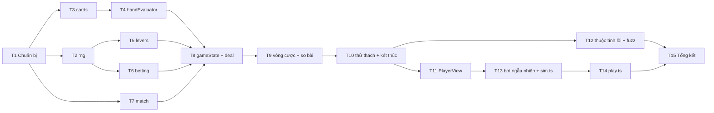

# Phase 1 – Lõi luật chơi: danh sách task

Nhánh: `feat/core-game-mechanics`. Nguồn: `docs/plan.md` (Phase 1 và bảng quyết định), cùng các skill `game-rules-core`, `poker-engine`, `lever-challenge`, `testing-vitest`.

**Mục tiêu của phase:** chạy hết được một trận bằng dòng lệnh ở cả hai chế độ (tự đấu và tương tác), và toàn bộ test lõi xanh.

**Quy ước cho mọi task:**
- Một task chỉ xong khi `npm run typecheck`, `lint`, `format:check` và `test` đều qua.
- Không dùng `Math.random` hay `Date.now` trong `src/core` và `src/ai`.
- Mọi con số đọc từ `src/config.ts`.
- Mỗi task nên là một commit riêng.

## Thứ tự và phụ thuộc

| # | Task | Tệp chính | Phụ thuộc |
| --- | --- | --- | --- |
| T1 | Chuẩn bị công cụ và config | `package.json`, `src/config.test.ts`, `eslint.config.js` | – |
| T2 | RNG có hạt giống | `src/core/rng.ts` | T1 |
| T3 | Bộ bài | `src/core/cards.ts` | T1 |
| T4 | Bộ xếp hạng bài | `src/core/handEvaluator.ts` | T3 |
| T5 | Cần gạt và L(m) | `src/core/levers.ts` | T2 |
| T6 | Cược | `src/core/betting.ts` | T2 |
| T7 | Tỉ số trận | `src/core/match.ts` | T1 |
| T8 | Kiểu trạng thái, `createMatch`, `deal` | `src/core/gameState.ts`, `src/core/rules.ts`, `src/core/testing.ts` | T4–T7 |
| T9 | Vòng cược, lật lá, so bài | `src/core/rules.ts` | T8 |
| T10 | Thử thách, kết thúc ván và trận | `src/core/rules.ts` | T9 |
| T11 | `PlayerView` và `viewFor` | `src/core/rules.ts` | T10 |
| T12 | Thuộc tính lõi, snapshot, fuzz | `src/core/rules.property.test.ts` | T10 |
| T13 | Bot ngẫu nhiên và `scripts/sim.ts` | `src/ai/baselineBots.ts`, `scripts/sim.ts` | T11 |
| T14 | Chơi tương tác `scripts/play.ts` | `scripts/play.ts` | T13 |
| T15 | Tổng kết phase | `docs/plan.md`, PR | T12, T14 |

---

## T1 – Chuẩn bị công cụ và config

- [ ] Cài devDependency `tsx` và `pokersolver`.
- [ ] Viết `src/types/pokersolver.d.ts`, chỉ khai báo tối thiểu `Hand.solve` và `Hand.winners`.
- [ ] Thêm script npm `sim` (chạy `tsx scripts/sim.ts`) và `play` (chạy `tsx scripts/play.ts`).
- [ ] Thêm luật ESLint: chỉ `*.test.ts` và `scripts/**` được import `src/core/testing.ts`.
- [ ] Viết `src/config.test.ts`, kiểm tra các ràng buộc:
  - `1 ≤ minDanger ≤ maxDanger ≤ count − 1`
  - `BETTING.maxLevel ≤ LEVERS.count`
  - `startLevel ≤ maxLevel`
  - `raiseStep ≥ 1`
  - `winsNeeded` của bo3, bo5, bo7 lần lượt là 2, 3, 4

**Xong khi:** `npm run sim` chạy được với một `scripts/sim.ts` tạm thời in ra "ok", và test config xanh.

## T2 – RNG có hạt giống (`rng.ts`)

- [ ] Viết class `Rng` theo thuật toán mulberry32 với các hàm `next()`, `int(n)`, `pick(arr)`, `shuffle(arr)`, getter `state`. `shuffle` dùng Fisher-Yates và trả mảng mới, không sửa mảng đầu vào.
- [ ] Test:
  - Cùng hạt giống cho cùng dãy số.
  - Tạo `Rng` mới từ `rng.state` thì dãy tiếp theo giống hệt.
  - `int(n)` luôn nằm trong `[0, n)`.
  - `shuffle` trả về một hoán vị và không sửa input.
  - Phân phối của `int(6)` qua 60.000 lần nằm trong ±2% mỗi giá trị.

## T3 – Bộ bài (`cards.ts`)

- [ ] Kiểu `Card = number` với công thức `rank * 4 + suit`, cùng các hàm `rankOf`, `suitOf`, `newDeck()` (52 lá theo thứ tự cố định), `cardToString` (`'As'`, `'Td'`), `parseCards`.
- [ ] Test:
  - `newDeck` có 52 lá không trùng.
  - `cardToString` và `parseCards` chuyển qua lại không mất thông tin với cả 52 lá.
  - `parseCards` throw khi gặp lá sai hoặc lá trùng.

## T4 – Bộ xếp hạng bài (`handEvaluator.ts`)

**Luật cốt lõi.** Thứ tự hạng tay từ mạnh đến yếu:

| Hạng | Tên | `HandRank` | Ví dụ |
| --- | --- | --- | --- |
| 1 (mạnh nhất) | Thùng phá sảnh lớn (Royal Flush) | `royalFlush` | A K Q J 10 cùng chất |
| 2 | Thùng phá sảnh (Straight Flush) | `straightFlush` | 5–6–7–8–9 bích |
| 3 | Tứ quý (Four of a Kind) | `fourOfAKind` | 4 quân Át |
| 4 | Cù lũ (Full House) | `fullHouse` | K-K-K-Q-Q |
| 5 | Thùng (Flush) | `flush` | 5 lá cùng chất, không cần liên tiếp |
| 6 | Sảnh (Straight) | `straight` | 5 lá liên tiếp, không cần cùng chất |
| 7 | Sám cô (Three of a Kind) | `threeOfAKind` | 3 lá cùng giá trị |
| 8 | Hai đôi (Two Pair) | `twoPair` | A-A và K-K |
| 9 | Một đôi (One Pair) | `onePair` | 2 lá cùng giá trị |
| 10 (yếu nhất) | Mậu thầu (High Card) | `highCard` | Không có bộ nào; so lá cao nhất trước |

Mẹo nhớ: Thùng phá sảnh > Tứ quý > Cù lũ > Thùng > Sảnh > Sám cô > Hai đôi > Một đôi > Mậu thầu. Cách so khi cùng hạng xem bảng đầy đủ trong skill `poker-engine`.

- [ ] Viết `evaluate7(cards)` trả về `HandValue`, theo công thức `(category << 20) | kickers`, chấm trực tiếp trên 7 lá bằng `counts` và `suitMask` mà không duyệt 21 tổ hợp. Kèm `compareHands` và `handCategory`.
- [ ] Viết `handRank(v)` trả về `HandRank`. Thùng phá sảnh có lá cao nhất là A thì trả `royalFlush`. Lõi chỉ trả mã; tên hiển thị để Phase 2 thêm vào i18n.
- [ ] Không cấp phát mảng mới trong vòng lặp nóng: tái sử dụng buffer ở cấp module.
- [ ] Test thứ tự hạng: lấy một tay đại diện cho mỗi hạng trong 10 hạng, kiểm tra giá trị giảm dần nghiêm ngặt và `handRank` của mỗi tay khớp bảng.
- [ ] Test các trường hợp biên bằng `it.each`, theo bảng trong skill `poker-engine`:
  - Thùng phá sảnh lớn thắng thùng phá sảnh K cao.
  - Sảnh A-5, thùng phá sảnh A-5, không có sảnh vòng.
  - Hai bộ ba, bộ ba kèm hai đôi, ba đôi.
  - Tứ quý trên bàn, 6–7 lá cùng chất, vừa có sảnh vừa có thùng, bàn tự thắng.
  - Cùng giá trị, khác chất thì hòa.
- [ ] Test mỗi hạng tay có ca so kicker trong cùng hạng.
- [ ] Đối chiếu `pokersolver` trên 10.000 cặp tay có hạt giống. Khi lệch, in ra bài để tái hiện.
- [ ] Benchmark 600 lần chấm 7 lá, bỏ qua khi chạy trên CI. Ngưỡng tham khảo dưới 10 ms trên máy dev.

**Xong khi:** không lệch `pokersolver` ở cặp tay nào.

## T5 – Cần gạt và L(m) (`levers.ts`)

- [ ] Viết `setupLevers(rng)`: rút số cần Nguy hiểm `d` đều trong `[minDanger, maxDanger]` trước, rồi `rng.shuffle` vị trí.
- [ ] Viết `pullLever(board, index)`: trả board mới kèm `danger`. Throw `IllegalActionError` khi `index` ngoài khoảng hoặc cần đã kéo. Đặt `IllegalActionError` trong `src/core/errors.ts`.
- [ ] Viết `dangerProbability(m)`, tính bằng công thức tổ hợp từ config, không viết tay bảng số.
- [ ] Test:
  - L(m) khớp 1/2, 11/15, 17/20, 23/25, 29/30, 1 với sai số 1e-9, và L(0) = 0.
  - Mô phỏng 100.000 lần khớp L(m) trong ±0,01.
  - `d` phân phối đều trên 1–5.
  - Vị trí nào cũng có lúc là Nguy hiểm.
  - Throw khi kéo lại cần đã kéo.

## T6 – Cược (`betting.ts`)

- [ ] Kiểu `Street`, `BetMove`, `BettingState` (`street`, `level`, `called`, `raisedThisStreet`, `actedThisStreet`, `toAct`).
- [ ] Viết `startBetting(firstActor)` và `legalActions(betting)` theo bảng trong skill `poker-engine`.
- [ ] Viết `applyBet(betting, seat, move, firstActor)` trả về kết quả dạng discriminated union:
  - `continue`: vẫn trong vòng, kèm `betting` mới.
  - `nextStreet`: sang vòng mới, kèm `betting` mới.
  - `showdown`: hết river.
  - `runout`: cả hai đã theo ở `maxLevel`.
  - `fold`: kèm `loser` và `pulls`.
- [ ] Viết `foldPulls(betting, seat)` theo công thức `max(called[seat], minPullOnFold)`.
- [ ] Test `legalActions` cho các tình huống:
  - Lượt đầu vòng.
  - Bị tăng.
  - Bị tăng lại (người đã tăng thì chỉ còn Theo hoặc Bỏ).
  - Mức đã là 6.
  - Đã dùng lượt tăng.
- [ ] Test kết thúc vòng với các chuỗi Xem–Xem, Tăng–Theo, Tăng–Tăng–Theo, và Tất tay–Theo (phải ra `runout`).
- [ ] Test `foldPulls`:
  - Bỏ ngay lượt đầu thì kéo 1.
  - Đang 2, bị tăng lên 3, Bỏ thì kéo 2.
  - Bị Tất tay khi đang 3, Bỏ thì kéo 3.

## T7 – Tỉ số trận (`match.ts`)

- [ ] Viết `winsNeeded(mode)`, `isMatchOver(wins, mode)`, `matchWinner(wins, mode)`. Đây đều là hàm thuần trên `[number, number]`.
- [ ] Test cả ba chế độ bo3, bo5, bo7, và trường hợp chưa ai đủ số thắng.

## T8 – Kiểu trạng thái, `createMatch` và `deal`

- [ ] Trong `gameState.ts`, khai báo các kiểu `Seat`, `Phase`, `Action`, `GameState`, `ChallengeState`, `RoundResult` và `GameEvent` (discriminated union, đủ các loại sự kiện trong skill `game-rules-core`).
- [ ] Viết `createMatch({ mode, seed })`: trả state ở phase `deal`, `round = 0`, chưa chia bài.
- [ ] Viết `applyAction(state, { type: 'deal' })`. Thứ tự rút RNG như sau:
  1. Chọn người đi trước.
  2. Xáo bộ bài.
  3. Chia 2 lá cho ghế 0, 2 lá cho ghế 1, rồi 5 lá chung.

  Sau đó đặt `revealed = 0`, mức cược về `startLevel`, chuyển sang phase `betting`. Phát sự kiện `roundStarted` và `holeCardsDealt`.
- [ ] Hành động sai phase thì throw `IllegalActionError`.
- [ ] Viết `src/core/testing.ts` gồm `cards`, `deepFreeze`, `withCards`, `withLevers`, `play`.
- [ ] Test:
  - `deal` chia đúng 9 lá không trùng.
  - Không sửa input (dùng `deepFreeze`).
  - Gọi `deal` ở phase `betting` thì throw.

## T9 – Vòng cược, lật lá, so bài

- [ ] Xử lý hành động `bet` trong `applyAction`: kiểm tra đúng lượt, đúng phase, nằm trong `legalActions`, rồi gọi `applyBet`.
- [ ] Sang vòng mới thì tăng `revealed` (0 → 3 → 4 → 5) và phát `streetRevealed`.
- [ ] Gặp `runout` thì lật hết lá chung còn lại (phát từng `streetRevealed`) rồi so bài.
- [ ] So bài: phát `showdown` với `holes`, giá trị tay và `winner`.
  - Có người thắng: phát `challengeStarted` cho người thua với `pulls = level`.
  - Hòa: phát `roundEnded` loại `draw/pokerTie`, cộng `draws + 1`, chuyển sang `roundResult`.
- [ ] Gặp `fold`: phát `folded` rồi `challengeStarted` với `pulls = foldPulls`. Không phát `showdown`.
- [ ] Vào `challenge` thì gọi `setupLevers` bằng RNG của ván.
- [ ] Test:
  - Người đi trước mở lời ở cả 4 vòng.
  - Bỏ ở lượt đầu dẫn tới `pulls = 1`.
  - Bỏ sau khi bị tăng thì `pulls` bằng mức đã theo.
  - Tất tay được Theo: lật đủ lá, so bài, `pulls = 6`.
  - Tất tay bị Bỏ: người Bỏ kéo mức đã theo.
  - So bài hòa thì không có `challengeStarted`.
  - Sai lượt hoặc hành động không hợp lệ thì throw.

## T10 – Thử thách, kết thúc ván và trận

- [ ] Xử lý hành động `pull` trong `applyAction`: chỉ ghế `loser` được kéo, gọi `pullLever`, phát `leverPulled`.
  - Trúng Nguy hiểm: đối thủ của người kéo `+1` thắng, phát `roundEnded` loại `win/danger`.
  - Kéo đủ số mà toàn Safe: phát `roundEnded` loại `draw/allSafe`, cộng `draws + 1`.
- [ ] Có người đủ `winsNeeded` thì phát `matchEnded` và chuyển sang `matchOver`. Nếu chưa thì chuyển sang `roundResult` và chờ `deal`.
- [ ] Test:
  - Dừng ngay khi trúng Nguy hiểm; kéo tiếp thì throw.
  - Kéo toàn Safe thì hòa.
  - Ghế không thua mà kéo thì throw.
  - Kết thúc trận đúng ở cả bo3, bo5, bo7.
  - Qua nhiều ván có hạt giống, cả hai ghế đều từng được đi trước.

## T11 – `PlayerView` và `viewFor`

- [ ] Khai báo kiểu `PlayerView` riêng, không dùng `Partial<GameState>`. Các trường đúng như skill `game-rules-core`, kèm `legal: BetMove[]`.
- [ ] Viết `viewFor(state, seat)`:
  - Lá chung chỉ gồm `board.slice(0, revealed)`.
  - Bài đối thủ chỉ có khi đã so bài.
  - Cần chưa kéo hiện là `'unknown'`.
- [ ] Test:
  - Trước khi so bài thì không có bài đối thủ.
  - Không có `rngState`, bộ bài còn lại hay lá chung chưa lật.
  - Tập khóa của view khớp danh sách cố định.
  - Trạng thái cần chỉ lộ ra ở các cần đã kéo.

## T12 – Thuộc tính lõi, snapshot, fuzz

- [ ] Test không sửa input: `deepFreeze` state rồi gọi mọi loại hành động.
- [ ] Test tái hiện: cùng hạt giống và cùng chuỗi hành động cho ra `events` giống hệt.
- [ ] Một `toMatchInlineSnapshot` ngắn cho chuỗi loại sự kiện của một hạt giống cố định.
- [ ] Fuzz: chạy 200 trận hai bên chọn ngẫu nhiên (có hạt giống) tới `matchOver`. Sau mỗi bước kiểm tra các bất biến:
  - `1 ≤ level ≤ 6`
  - `called[i] ≤ level`
  - `wins` không vượt `winsNeeded`
  - `JSON.parse(JSON.stringify(state))` bằng `state`
- [ ] Thử phá luật một chỗ (ví dụ cho Bỏ kéo mức mới thay vì mức đã theo) để chắc test đỏ, rồi hoàn tác.

## T13 – Bot ngẫu nhiên và `scripts/sim.ts`

- [ ] Viết `src/ai/baselineBots.ts` gồm `createRandomBot(seed)`: chọn đều trong `view.legal`, kéo một cần `'unknown'` ngẫu nhiên. Bot chỉ nhận `PlayerView` và có RNG riêng. Phase 2 dùng lại bot này, Phase 3 thêm bot "luôn Theo" vào cùng file.
- [ ] Viết `scripts/sim.ts`: hai bot ngẫu nhiên tự đấu một trận, có các cờ:
  - `--seed <n>`
  - `--mode 3|5|7`
  - `--quiet` (chỉ in kết quả cuối)

  Log mỗi sự kiện một dòng dễ đọc, ví dụ `[V2] Ghế 1 Tăng → mức 3`, `[V2] Lật turn: 9h`, `[V2] Ghế 0 kéo cần 4: NGUY HIỂM`.
- [ ] Test `createRandomBot`: `move` luôn thuộc `view.legal`, và cùng hạt giống cho cùng quyết định.

**Xong khi:** `npm run sim -- --seed 42 --mode 5` chạy hết một trận, và chạy lại cho log giống hệt.

## T14 – Chơi tương tác (`scripts/play.ts`)

- [ ] Dùng readline. Người chơi ngồi ghế 0, bot ngẫu nhiên ngồi ghế 1, chọn chế độ bằng cờ `--mode`.
- [ ] Mỗi lượt in ra:
  - Bài của bạn và lá chung đã lật.
  - Mức cược, mức mình đã theo.
  - Các hành động hợp lệ đánh số. Bỏ và Theo kèm số cần sẽ phải kéo nếu thua.
- [ ] Khi vào thử thách, in danh sách cần còn lại để chọn số. Khi so bài, lật bài bot.
- [ ] Dùng chung bộ định dạng log với `sim.ts`, tách ra `scripts/format.ts`.

**Xong khi:** bạn tự chơi hết một trận bo3 trong terminal.

## T15 – Tổng kết phase

- [ ] Đánh dấu `[x]` các mục Phase 1 trong `docs/plan.md`.
- [ ] Nếu trong lúc làm có đổi luật hoặc API so với skill (tên sự kiện, kiểu state), cập nhật các skill `game-rules-core`, `poker-engine`, `lever-challenge`.
- [ ] Chạy đủ `typecheck`, `lint`, `format:check`, `test`; chạy `test` hai lần để chắc không có test chập chờn.
- [ ] Chạy GitNexus `detect_changes` trước khi commit (theo `CLAUDE.md`).
- [ ] Mở PR từ `feat/core-game-mechanics` vào `main`.
