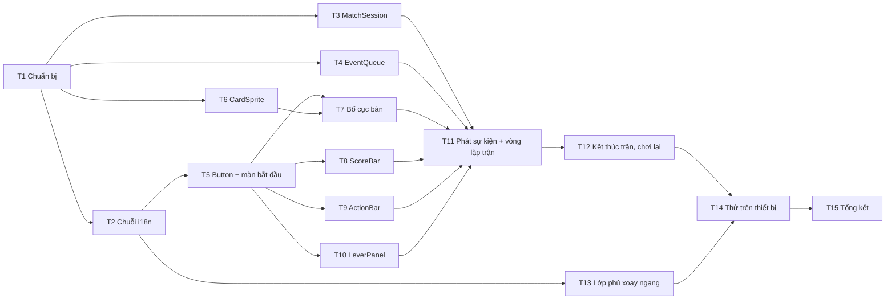

# Phase 2 – Bàn chơi bản nháp: danh sách task

Nhánh: `feat/drafting-table`. Nguồn: `docs/plan.md` (Phase 2 và bảng quyết định), bố cục trong `the-last-lever-thiet-ke.md` và `docs/stitch-ui-brief.md` (mục 3.4, 3.5, 3.7). Skill nên đọc: `game-rules-core`, `scenes`, `tweens`, `graphics-and-shapes`, `text-and-bitmaptext`, `input-keyboard-mouse-touch`, `scale-and-responsive`.

**Mục tiêu của phase:** bấm nút chơi hết một trận với bot ngẫu nhiên, trên máy tính và trên điện thoại qua `npm run dev:host`. Mọi thứ vẽ bằng hình khối và chữ, chưa có hình thật hay hiệu ứng.

**Quy ước cho mọi task:**
- Scene chỉ diễn hoạt: mọi thay đổi trạng thái đi qua `applyAction`, scene phát lại `events`. Scene không tự tính luật (ví dụ không tự tính số cần khi Bỏ, dùng `foldPulls`).
- Phần nào không cần Phaser thì tách ra file không import Phaser để test được trên Node (`tests/` chạy với `environment: 'node'`).
- Mọi chuỗi hiển thị đi qua `t()`; thêm khóa vào `vi.ts` trước rồi `en.ts`.
- Mọi kích thước, tọa độ, màu, thời lượng tween nằm trong `src/config.ts`.
- Người chơi luôn ngồi ghế 0, bot ghế 1 (giống `scripts/play.ts`).
- Một task chỉ xong khi `npm run typecheck`, `lint`, `format:check` và `test` đều qua. Mỗi task nên là một commit riêng.

## Thứ tự và phụ thuộc

| # | Task | Tệp chính | Phụ thuộc |
| --- | --- | --- | --- |
| T1 | Chuẩn bị: config bố cục, màu, thời lượng; khung thư mục | `src/config.ts`, `eslint.config.js`, `tests/config.test.ts` | – |
| T2 | Chuỗi giao diện | `src/i18n/vi.ts`, `src/i18n/en.ts`, `tests/i18n/i18n.test.ts` | T1 |
| T3 | Phiên trận (người chơi + bot) | `src/session/matchSession.ts` | T1 |
| T4 | Hàng đợi sự kiện | `src/session/eventQueue.ts` | T1 |
| T5 | Nút dùng chung và màn bắt đầu | `src/ui/Button.ts`, `src/scenes/BootScene.ts`, `src/main.ts` | T2 |
| T6 | Lá bài | `src/ui/cardFace.ts`, `src/ui/CardSprite.ts` | T1 |
| T7 | Bố cục bàn bằng hình khối | `src/scenes/TableScene.ts`, `src/ui/BetMeter.ts` | T5, T6 |
| T8 | Thanh tỉ số | `src/ui/ScoreBar.ts` | T5 |
| T9 | Thanh hành động | `src/ui/actionBarModel.ts`, `src/ui/ActionBar.ts` | T5 |
| T10 | Bảng cần gạt bản thô | `src/ui/LeverPanel.ts` | T5 |
| T11 | Phát sự kiện và vòng lặp trận | `src/scenes/TableScene.ts` | T3, T4, T7–T10 |
| T12 | Kết thúc trận và chơi lại | `src/scenes/TableScene.ts` | T11 |
| T13 | Lớp phủ "Hãy xoay ngang" | `index.html`, `src/style.css`, `src/main.ts` | T2 |
| T14 | Thử trên máy tính và điện thoại | – | T12, T13 |
| T15 | Tổng kết phase | `docs/plan.md`, skill, PR | T14 |

---

## T1 – Chuẩn bị

- [x] Thêm vào `src/config.ts`:
  - `COLORS`: bảng màu theo design system trong `docs/stitch-ui-brief.md` (nền đêm, gỗ, nỉ bàn, hổ phách, chữ kem, chữ mờ, Safe xanh, Nguy hiểm đỏ). Lưu dạng số `0xRRGGBB` cho Graphics, kèm hàm nhỏ đổi sang chuỗi `'#rrggbb'` cho Text.
  - `LAYOUT`: các vùng của màn Bàn chơi theo bảng mục 3.4 của UI brief (thanh trên y 0–56, đối thủ y 56–330, bàn y 300–540, bài người chơi x 24–330 y 470–700, thanh hành động x 360–1256 y 620–704), kích thước lá bài (lá người chơi ~130×180, lá chung và lá đối thủ nhỏ hơn), ô mức cược 40 px, bán kính bo góc, cỡ chữ.
  - `TIMING`: thời lượng chia bài, lật lá, hiện hành động cược, banner, lộ kết quả cần (bản thô), độ trễ suy nghĩ tạm của bot. Phase 3 sẽ thay độ trễ bot bằng khoảng 0,8–2,5 giây.
- [x] Tạo thư mục `src/session/` cho phần điều phối trận không phụ thuộc Phaser. Thêm luật ESLint: `src/session/` không import `phaser`, `scenes/`, `ui/`.
- [x] Cập nhật khối kiến trúc trong `CLAUDE.md` thêm dòng `session/`.
- [x] Mở rộng `tests/config.test.ts`:
  - Mọi vùng trong `LAYOUT` nằm trọn trong 1280×720.
  - Chiều cao nút hành động và cần gạt ≥ `DISPLAY.minTouchSize`.
  - 6 ô mức cược và 5 nút hành động vừa trong vùng của chúng.

## T2 – Chuỗi giao diện

- [x] Thêm khóa vào `vi.ts` rồi `en.ts`, lấy bản dịch từ bảng UI copy cuối `docs/stitch-ui-brief.md`:
  - Màn bắt đầu: `BEST OF {n}`, nút bắt đầu.
  - Tên hai bên: "Bạn", tên bot tạm.
  - Vòng cược: Trước flop / Flop / Turn / River.
  - 5 hành động và phụ đề: "lên {n}", "thua: kéo {n} cần", "kéo {n} cần".
  - 10 tên hạng tay `hand.royalFlush` … `hand.highCard` (Phase 1 để dành cho Phase 2).
  - Banner: ai đi trước, hành động của mỗi bên, so bài, bỏ bài, "{name} phải kéo {n} cần", An toàn, Nguy hiểm, ván hòa (hòa bài, kéo toàn An toàn), +1 chiến thắng, "Đang suy nghĩ…".
  - Kết thúc: thắng/thua trận, tỉ số, số ván hòa, "Ván tiếp", "Chơi lại".
  - Lớp phủ: "Hãy xoay ngang điện thoại để chơi".
- [x] Thêm test vào `tests/i18n/i18n.test.ts`: mỗi khóa có cùng tập placeholder `{...}` ở `vi` và `en`.
- [x] Đọc `?lang=en` trên URL (qua `isLocale`) để thử bản tiếng Anh trước khi có menu ở Phase 5.

## T3 – Phiên trận (`matchSession.ts`)

Lớp mỏng giữ `GameState` hiện tại và nối người chơi với bot. Không import Phaser, để test được và để `TableScene` chỉ còn việc diễn hoạt.

- [x] `createSession({ mode, seed, bot? })`: tạo trận bằng `createMatch`. Bot mặc định là `createRandomBot(seed + 1)`.
- [x] Các thành phần:
  - `view`: `viewFor(state, 0)`, thứ duy nhất UI đọc để vẽ trạng thái.
  - `turn`: `'deal' | 'human' | 'bot' | 'over'`, suy ra từ `currentActor` và `phase`.
  - `deal()`, `humanBet(move)`, `humanPull(lever)`, `botAct()`: mỗi hàm gọi `applyAction`, cập nhật state, trả `GameEvent[]`.
- [x] `botAct()` chỉ đưa cho bot `viewFor(state, 1)`. Hành động của bot vẫn đi qua `applyAction` nên luật vẫn được kiểm.
- [x] Gọi sai lượt (ví dụ `humanBet` khi đang là lượt bot) thì throw và state không đổi.
- [x] Test (`tests/session/matchSession.test.ts`):
  - Người chơi chọn ngẫu nhiên có hạt giống, chạy tới `'over'` ở cả bo3, bo5, bo7.
  - Bot giả ghi lại tham số: mọi lần gọi đều nhận `PlayerView` có `me === 1`, không có `holes`, `rngState`, `board` đầy đủ.
  - Cùng hạt giống và cùng chuỗi lựa chọn cho cùng chuỗi sự kiện.
  - Gọi sai lượt thì throw.

## T4 – Hàng đợi sự kiện (`eventQueue.ts`)

- [x] `EventQueue<E>` nhận hàm `play(event) => Promise<void>`, có `push(events)`, `busy`, `onIdle(cb)`, `dispose()`.
- [x] Phát lần lượt: sự kiện sau chỉ bắt đầu khi promise của sự kiện trước xong. `push` trong lúc đang phát thì nối vào cuối.
- [x] `onIdle` chạy một lần mỗi khi hàng đợi cạn; scene dùng nó để mở khóa input hoặc cho bot đi.
- [x] `dispose()` bỏ các sự kiện còn chờ và ngừng gọi `onIdle`; scene gọi khi `shutdown` để không chạy tween trên scene đã hủy.
- [x] Test (`tests/session/eventQueue.test.ts`) với `play` giả (promise tự resolve thủ công):
  - Đúng thứ tự, không chồng nhau.
  - `busy` đúng trong và sau khi phát.
  - `push` lúc đang phát thì nối tiếp.
  - Một lần `play` lỗi không làm kẹt hàng đợi (ghi lỗi ra console rồi phát tiếp).

## T5 – Nút dùng chung và màn bắt đầu

- [x] `src/ui/Button.ts`: Container gồm hình chữ nhật bo góc, nhãn, phụ đề tùy chọn. Có `setEnabled(bool)` (mờ 30%, tắt input), kiểu chính (nền hổ phách) và phụ (nền gỗ, viền hổ phách). Vùng chạm cao ≥ 64 px. Dùng lại ở ActionBar, màn bắt đầu và nút "Ván tiếp".
- [x] `BootScene` tối giản: tên game, khẩu hiệu, 3 nút BEST OF 3 / 5 / 7. Bấm nút thì `scene.start('TableScene', { mode, seed })`.
- [x] Hạt giống: lấy từ `?seed=` nếu có, không thì sinh ngẫu nhiên ở lớp hiển thị. Ghi hạt giống ra `console.info` để tái hiện lỗi bằng `npm run sim -- --seed`.
- [x] Đăng ký `TableScene` (khung rỗng) trong `main.ts`.

**Xong khi:** bấm một nút ở màn bắt đầu thì sang được `TableScene` trống, có chế độ và hạt giống đúng.

## T6 – Lá bài (`CardSprite`)

- [x] `src/ui/cardFace.ts` (không import Phaser): `cardFace(card)` trả `{ rank: 'A' | 'K' | … | '10' | … , suit: '♠' | '♥' | '♦' | '♣', red: boolean }`.
- [x] `CardSprite`: Container vẽ mặt ngửa (nền trắng bo góc, giá trị và chất ở góc, chất lớn ở giữa, đỏ cho ♥♦) và mặt úp (nền đỏ sẫm, viền). Có các kích thước theo `LAYOUT`.
- [x] Hàm `flip(card)` lật bằng tween co `scaleX` về 0 rồi mở ra, trả `Promise`.
- [x] Kiểm tra Saira Stencil có ký tự ♠♥♦♣ không. Nếu không có, để `DISPLAY.fontFamily` rơi về font hệ thống cho riêng ký tự chất, hoặc vẽ chất bằng Graphics.
- [x] Test `cardFace` cho cả 52 lá: không trùng, `T` thành `10`, đúng màu.

## T7 – Bố cục bàn bằng hình khối

- [x] `TableScene.create` vẽ tĩnh theo `LAYOUT`, từ xa đến gần:
  - Nền tối, chỗ đối thủ là hình khối giữ chỗ (đầu tròn, thân chữ nhật) kèm biển tên và 2 lá úp.
  - Mặt bàn hình thang (hẹp ở xa, rộng ở gần) màu nỉ, viền gỗ.
  - 5 ô lá chung (viền đứt khi chưa lật) và nhãn vòng cược hiện tại.
  - `BetMeter` (`src/ui/BetMeter.ts`): nhãn "Mức cược" và 6 ô vuông, ô ≤ mức hiện tại sáng hổ phách. Có `setLevel(n)` kèm tween nhẹ.
  - Hai lá của người chơi ở góc dưới trái.
- [x] Viết hàm `render(view: PlayerView)` vẽ lại toàn bộ bàn từ view. T11 dùng nó để đồng bộ lại sau mỗi chuỗi sự kiện, tránh lệch giữa hình và state.

**Xong khi:** gọi `render` với view giả ở các vòng preflop, flop, river trông đúng bố cục trong UI brief.

## T8 – Thanh tỉ số (`ScoreBar`)

- [x] Dải trên cùng: bên trái "Bạn" với số chấm tròn bằng `winsNeeded`, bên phải tên bot, giữa là "Hòa: {n}". Chấm đặc = đã thắng, rỗng = chưa.
- [x] `setScore(wins, draws)` có tween nhẹ ở chấm vừa đặc.

## T9 – Thanh hành động (`ActionBar`)

- [ ] `src/ui/actionBarModel.ts` (không import Phaser): `actionBarModel(view)` trả 5 mục theo thứ tự `BET_MOVES`, mỗi mục gồm `move`, `enabled` (có trong `view.legal`), khóa nhãn, phụ đề đã điền số:
  - Tăng: "lên {level + raiseStep}".
  - Theo: "thua: kéo {level} cần".
  - Bỏ: "kéo {foldPulls(betting, me)} cần".
  - Tất tay: "lên {maxLevel}".
  - Xem bài: không phụ đề.
- [ ] `ActionBar`: 5 `Button` chia đều vùng `LAYOUT`, cao ≥ 64 px. `setModel(model)`, `setLocked(bool)`, gọi `onMove(move)` khi bấm. Bấm xong tự khóa ngay để không gửi hai lần.
- [ ] Test `actionBarModel`:
  - Lượt đầu vòng: Xem bài, Tăng, Bỏ, Tất tay bật; Theo tắt.
  - Bị tăng từ 2 lên 3: Theo hiện "kéo 3", Bỏ hiện "kéo 2".
  - Mức đã là 6: Tăng và Tất tay tắt.
  - Không phải lượt mình: cả 5 tắt.

## T10 – Bảng cần gạt bản thô (`LeverPanel`)

- [ ] Bảng giữa màn hình, nền phía sau tối đi. Tiêu đề "{name} phải kéo {n} cần".
- [ ] 6 hình chữ nhật đánh số 1–6 (cao ≥ 64 px): xám khi chưa kéo, xanh khi An toàn, đỏ khi Nguy hiểm.
- [ ] `open(loser, pulls)`, `reveal(lever, danger)` trả `Promise` (ngừng `TIMING` ngắn rồi đổi màu), `close()`.
- [ ] Chỉ nhận chạm khi người chơi là người thua và hàng đợi rảnh; cần đã kéo không nhận chạm. Gọi `onPull(lever)`.
- [ ] Chưa làm: trượt vào, bộ đếm "đã kéo x / n", tia điện, rung (để Phase 4).

## T11 – Phát sự kiện và vòng lặp trận

- [ ] `TableScene.init({ mode, seed })` tạo `MatchSession` và `EventQueue`. Tự `deal()` ván đầu.
- [ ] Ánh xạ mỗi `GameEvent` sang một hoạt ảnh trả `Promise` (dùng `tweens` và `time.delayedCall` của scene, không dùng `setTimeout`):
  - `roundStarted`: dọn bàn, banner "Ván {n} — {name} đi trước".
  - `holeCardsDealt`: chia 2 lá ngửa cho người chơi, 2 lá úp cho bot. Không bao giờ vẽ mặt bài bot ở bước này.
  - `betPlaced`: chữ ngắn cạnh người vừa đi ("Tăng lên 3"), `BetMeter.setLevel`.
  - `streetRevealed`: lật từng lá vào ô chung, đổi nhãn vòng.
  - `showdown`: lật bài bot, banner tên hạng tay hai bên và người thắng; hòa bài thì "không ai kéo cần".
  - `folded`: banner "{name} Bỏ bài — kéo {n} cần". Bài bot giữ úp (quyết định #7).
  - `challengeStarted`: `LeverPanel.open`.
  - `leverPulled`: `LeverPanel.reveal`.
  - `roundEnded`: đóng bảng cần, banner kết quả (+1 chiến thắng / hòa), `ScoreBar.setScore`.
  - `matchEnded`: chuyển sang T12.
- [ ] Khóa input: `ActionBar` và `LeverPanel` chỉ mở khi `queue.busy === false` và `session.turn === 'human'`.
- [ ] Khi hàng đợi rảnh (`onIdle`), xem `session.turn`:
  - `'human'`: `render(view)`, mở input.
  - `'bot'`: hiện "Đang suy nghĩ…", chờ `TIMING.botThinkMs`, gọi `botAct()`, đẩy sự kiện vào hàng đợi. Bot kéo cần cũng đi đường này, mỗi cần một lần.
  - `'deal'`: hiện nút "Ván tiếp"; bấm thì `deal()`.
  - `'over'`: không làm gì (T12 lo).
- [ ] Khi scene `shutdown`: `queue.dispose()`, gỡ listener.

**Xong khi:** chơi được nhiều ván liên tiếp, bấm loạn hay bấm nhanh liên tục không gây lỗi hoặc gửi hành động sai lượt (xem console không có `IllegalActionError`).

## T12 – Kết thúc trận và chơi lại

- [ ] Khi `matchEnded`: khóa toàn bộ input, hiện dòng kết quả "Bạn thắng trận 2–1" hoặc "Bạn thua trận", số ván hòa.
- [ ] Nút "Chơi lại" về `BootScene`. Kiểm tra chơi lại 2–3 lần liên tiếp không nhân đôi listener hay tween (log số listener nếu cần).
- [ ] `ResultScene` thật để Phase 5.

**Xong khi:** chơi hết một trận BEST OF 3 từ màn bắt đầu tới dòng kết quả rồi chơi lại được.

## T13 – Lớp phủ "Hãy xoay ngang"

- [ ] Làm bằng DOM và CSS, không cần Phaser: thêm `
` vào `index.html`, hiện bằng `@media (orientation: portrait) and (pointer: coarse)` trong `style.css`.
- [ ] `main.ts` điền chữ bằng `t('rotate.message')` và cập nhật lại khi đổi ngôn ngữ.
- [ ] Biểu tượng điện thoại xoay vẽ bằng CSS hoặc SVG nội tuyến, màu hổ phách.
- [ ] Không hiện trên máy tính kể cả khi cửa sổ hẹp và cao.

## T14 – Thử trên máy tính và điện thoại

- [ ] Máy tính: chơi hết một trận ở mỗi chế độ BEST OF 3, 5, 7. Gặp đủ các nhánh: bỏ bài, tất tay, so bài hòa, kéo trúng Nguy hiểm, kéo toàn An toàn.
- [ ] Thử `?lang=en` một trận.
- [ ] Điện thoại qua `npm run dev:host`:
  - Chạm được mọi nút và cần bằng một lần chạm.
  - Cầm dọc hiện lớp phủ, xoay ngang thì biến mất và game vẫn đúng tỉ lệ.
  - Chữ có dấu (ệ, ấ, ổ, ữ, Đ) và ký tự chất hiển thị đúng.
- [ ] Rà chuỗi gõ cứng: tìm chuỗi literal truyền vào `add.text`, `setText`, `Button` trong `src/scenes` và `src/ui`; mọi chuỗi hiển thị phải đi qua `t()`.
- [ ] Ghi lỗi tìm được kèm hạt giống; tái hiện bằng `npm run sim -- --seed` nếu lỗi nằm ở lõi.

## T15 – Tổng kết phase

- [ ] Đánh dấu `[x]` các mục Phase 2 trong `docs/plan.md`.
- [ ] Nếu đổi API lõi hoặc thêm quy ước mới (thư mục `session/`, cách phát sự kiện), cập nhật `CLAUDE.md` và skill `game-rules-core`.
- [ ] Chạy đủ `typecheck`, `lint`, `format:check`, `test`, và `npm run build` để chắc bản build không lỗi.
- [ ] Chạy GitNexus `detect_changes` trước khi commit (theo `CLAUDE.md`).
- [ ] Mở PR từ `feat/drafting-table` vào `main`.
