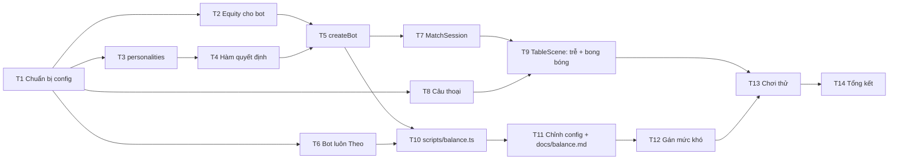

# Phase 3 – Bot: danh sách task

Nhánh: `feat/bot`. Nguồn: `docs/plan.md` (Phase 3, quyết định #4, #5, #6, #9), mục Bot trong `the-last-lever-thiet-ke.md`. Skill nên đọc: `bot-ai`, `game-rules-core`, `poker-engine`, `lever-challenge`, `testing-vitest`, `time-and-timers`.

**Mục tiêu của phase:** thay bot ngẫu nhiên bằng bot thật có ba tính cách. Mỗi tính cách thắng bot ngẫu nhiên ≥ 60% và bot luôn-Theo ≥ 55% trên 1.000 trận, mọi cặp tính cách nằm trong 35–65%, ba tính cách đã gán vào Dễ / Vừa / Khó, và khi chơi tay thấy được bot lừa (bong bóng thoại nói dối, ván tăng khi bài yếu).

**Những gì đã có sẵn (không làm lại):**
- `src/ai/equity.ts`: `estimateEquity(hole, board, rng, trials = EQUITY.trials)` trả một số (thắng + hòa/2). Thẻ "BỘ BÀI" đang dùng. Đo nhanh trên máy tính: khoảng 0,4 ms cho 300 lần trước flop.
- `src/ai/types.ts`: `Bot` (`chooseBet`, `chooseLever` trả kèm `talk?: TalkLabel`), `TalkLabel = 'strong' | 'weak' | 'neutral'`.
- `src/ai/baselineBots.ts`: `createRandomBot(seed)`.
- `src/core/levers.ts`: `dangerProbability(m)` là L(m) tính từ `LEVERS`. `src/core/betting.ts`: `foldPulls`, `STREETS`.
- `MatchSession` nhận `bot?: Bot` và chỉ đưa cho bot `viewFor(state, BOT)`.
- Menu đã có Dễ / Vừa / Khó / Ngẫu nhiên, `OPPONENTS` có tên và màu nhấn theo mức khó, thống kê lưu theo mức khó. Phase 3 chỉ cần nối mức khó với tính cách.
- `SpeechBubble` đã có `say(line, note)` và `hide()`.

**Quy ước cho mọi task:**
- `src/ai/` không import Phaser, `scenes/`, `ui/`, `i18n/`. Hàm public của bot chỉ nhận `PlayerView`. Bot trả nhãn, lớp hiển thị chọn câu qua `t()`.
- Bot dùng `Rng` riêng có hạt giống, tách khỏi RNG của ván. Không dùng `Math.random` hay `Date.now` trong `src/ai`.
- Mọi con số (ngưỡng, hệ số, tỉ lệ, độ trễ) nằm trong `src/config.ts`. L(m) luôn lấy từ `dangerProbability`.
- Phần quyết định tách thành hàm thuần nhận equity truyền vào, để test công thức mà không phụ thuộc mô phỏng.
- Một task chỉ xong khi `npm run typecheck`, `lint`, `format:check` và `test` đều qua. Mỗi task nên gọn trong một commit.

## Thứ tự và phụ thuộc

| # | Task | Tệp chính | Phụ thuộc |
| --- | --- | --- | --- |
| T1 | Chuẩn bị: khối `BOT` trong config | `src/config.ts`, `tests/config.test.ts` | – |
| T2 | Equity cho bot: cache và benchmark | `src/ai/equity.ts`, `tests/ai/equity.test.ts` | T1 |
| T3 | Ba tính cách và hệ số sợ | `src/ai/personalities.ts` | T1 |
| T4 | Hàm quyết định thuần | `src/ai/botBrain.ts` | T3 |
| T5 | `createBot`: lừa theo ván, chọn cần, nhãn thoại | `src/ai/botBrain.ts`, `src/ai/types.ts` | T2, T4 |
| T6 | Bot cơ sở luôn Theo | `src/ai/baselineBots.ts` | T1 |
| T7 | Nối bot vào `MatchSession` | `src/session/matchSession.ts` | T5 |
| T8 | Câu thoại vi/en | `src/i18n/vi.ts`, `src/i18n/en.ts`, `src/ui/talkModel.ts` | T1 |
| T9 | Độ trễ suy nghĩ và bong bóng thoại trên bàn | `src/scenes/TableScene.ts` | T7, T8 |
| T10 | Script cân bằng | `scripts/balance.ts`, `package.json` | T5, T6 |
| T11 | Chỉnh config theo báo cáo | `src/config.ts`, `docs/balance.md` | T10 |
| T12 | Gán Dễ / Vừa / Khó | `src/config.ts`, `src/scenes/TableScene.ts` | T11 |
| T13 | Chơi thử trên máy tính và điện thoại | – | T9, T12 |
| T14 | Tổng kết phase | `docs/plan.md`, skill `bot-ai`, PR | T13 |

---

## T1 – Chuẩn bị config

- [x] Thêm khối `BOT` vào `src/config.ts`:
  - `thinkMs: { min: 800, max: 2500 }` thay cho `TIMING.botThink` (xoá khóa cũ ở T9 khi không còn ai dùng).
  - `talkChance: 0.3`, `talkStrongAt: 0.6`, `talkWeakAt: 0.4`, `talkMs: 2000`.
  - `fearWhenOpponentOneAway: 0.2`, `fearWhenLeading: -0.1`.
  - `personalities`: `cautious`, `balanced`, `reckless`, mỗi cái có `fear`, `raiseAt`, `allInAt`, `bluffRaise`, `bluffAllIn`, `lieRate` theo bảng trong skill `bot-ai` (Thận trọng 1,3 / 0,70 / 0,90 / 0 / 0 / 10%; Cân bằng 1,0 / 0,60 / 0,80 / 0 / 0 / 20%; Liều lĩnh 0,7 / 0,50 / 0,65 / 15% / 5% / 35%).
  - Số lần mô phỏng của bot dùng lại `EQUITY.trials`, không thêm khóa thứ hai.
- [x] Xuất kiểu `PersonalityId = keyof typeof BOT.personalities` và danh sách `PERSONALITIES`.
- [x] Thêm `DIFFICULTY_PERSONALITY: Record<Difficulty, PersonalityId>` với giá trị tạm (`easy → cautious`, `medium → balanced`, `hard → reckless`); T12 chốt lại theo số liệu.
- [x] Mở rộng `tests/config.test.ts`:
  - `0 < thinkMs.min ≤ thinkMs.max`.
  - Mỗi tính cách: ngưỡng và tỉ lệ nằm trong [0, 1], `raiseAt < allInAt`, `fear > 0`.
  - `talkWeakAt < talkStrongAt`.
  - `DIFFICULTY_PERSONALITY` gán ba mức khó cho ba tính cách khác nhau.

## T2 – Equity cho bot

- [x] Giữ API hiện tại (`estimateEquity` trả một số). Sửa skill `bot-ai` ở T14 cho khớp, vì skill đang mô tả kiểu `Equity` với `win`, `tie`, `lose`.
- [x] Bot tự cache equity theo khóa bộ lá (bài riêng + lá chung đã lật) trong một ván. Bot thường quyết định nhiều lần ở cùng một vòng (bị tăng lại), nên cache vừa đỡ tính lại vừa giữ quyết định nhất quán. Cache làm ở T5, trong bot, không đặt trong `equity.ts`.
- [x] Thêm test benchmark vào `tests/ai/equity.test.ts`: 300 lần trước flop, lấy thời gian tốt nhất của vài lần chạy, đặt ngưỡng rộng cho máy CI (ví dụ < 15 ms) để không chập chờn. Ghi chú trong test rằng mốc thật là < 50 ms trên điện thoại và được đo tay ở T13.
- [ ] Chỉ tính đến Web Worker hoặc giảm `EQUITY.trials` nếu số đo trên điện thoại ở T13 vượt 50 ms. Nhớ tính cả lượt thẻ "BỘ BÀI" chạy cùng lúc. (Chờ số đo ở T13.)

## T3 – Ba tính cách (`personalities.ts`)

- [x] `personality(id)` trả cấu hình từ `BOT.personalities`.
- [x] `fearFactor(p, view)`: `p.fear`, cộng `fearWhenOpponentOneAway` khi `wins[opp] === winsNeeded − 1`, cộng `fearWhenLeading` khi `wins[me] > wins[opp]`. Hai điều chỉnh cộng dồn được.
- [x] Test (`tests/ai/personalities.test.ts`): bốn trường hợp tỉ số (đều, bot dẫn, đối thủ còn 1, cả hai cùng lúc) cho đúng hệ số.

## T4 – Hàm quyết định thuần (`botBrain.ts`)

Tách phần toán khỏi phần ngẫu nhiên. Hàm này không gọi RNG, không mô phỏng.

- [x] `finalLevel(view)`: m_cuối theo quyết định #6, `min(maxLevel, ceil(mức sau khi Theo + 0,5 × số vòng cược còn lại))`. Số vòng còn lại suy từ `STREETS` (preflop 3, flop 2, turn 1, river 0).
- [x] `decideBet(view, ctx)` với `ctx = { equity, fear, personality, bluff: 'none' | 'raise' | 'allIn' }`, trả `{ move, trace }`:
  - **Được Xem bài** (`check` hợp lệ): không bao giờ Bỏ. `allIn` nếu hợp lệ và (equity > `allInAt` hoặc `bluff === 'allIn'`); không thì `raise` nếu hợp lệ và (equity > `raiseAt` hoặc `bluff === 'raise'`); còn lại `check`.
  - **Bị tăng** (phải Theo hoặc Bỏ): rủi ro Bỏ = `L(foldPulls(view.betting, me))`; rủi ro đi tiếp = `(1 − equity) × L(m_cuối) × fear`. Đi tiếp khi rủi ro đi tiếp nhỏ hơn. Đi tiếp và còn quyền tăng thì xét `allIn` / `raise` theo ngưỡng như trên, còn lại `call`.
  - `trace` gồm `equity`, `fear`, `riskFold`, `riskGo`, `bluffed: boolean`. T10 dùng để đếm số lần lừa, T9 dùng để in log khi gỡ lỗi.
  - Kiểm tra cuối hàm: `move` phải thuộc `view.legal`, không thì throw.
- [x] Test (`tests/ai/botBrain.test.ts`), dựng `PlayerView` bằng tay trong `tests/testing.ts` nếu chưa có helper:
  - `finalLevel` ở bốn vòng và khi đã chạm mức 6.
  - Có `check` thì không bao giờ ra `fold`, kể cả equity 0.
  - Bị tăng từ 2 lên 3, equity thấp → `fold`; equity cao → `call`; cùng equity nhưng `fear` cao hơn đổi từ `call` sang `fold` ở một ca biên tính tay.
  - Ngưỡng Tăng và Tất tay đúng cho cả ba tính cách; mức đã là 6 thì không ra `raise`/`allIn`.
  - `bluff` ép tăng ở lượt Xem bài, nhưng khi bị tăng lại thì quay về công thức Theo/Bỏ.

## T5 – `createBot`

- [x] `createBot({ personality, seed }): Bot` trong `botBrain.ts`, giữ một `Rng` riêng.
- [x] Mỗi khi `view.round` đổi: xoá cache equity, rút một lần xem ván này có lừa không (`bluffAllIn` trước, rồi `bluffRaise`). Ván lừa chỉ ép tăng ở cơ hội hợp lệ đầu tiên, sau đó về `'none'`.
- [x] `chooseBet`: lấy equity (cache hoặc `estimateEquity(view.hole, view.board, rng)`), tính `fearFactor`, gọi `decideBet`.
- [x] Nhãn thoại cho lượt cược: với xác suất `talkChance` thì có `talk`. Nhãn thật theo equity (`strong` ≥ `talkStrongAt`, `weak` < `talkWeakAt`, còn lại `neutral`); với xác suất `lieRate` thì nói dối: `strong` ↔ `weak`, `neutral` đổi ngẫu nhiên sang một trong hai. Ghi `lied: boolean` vào `trace`.
- [x] `chooseLever`: chọn đều ngẫu nhiên trong các cần `'unknown'`. Không trả `talk` (câu khi vào thử thách do T9 lo, xem ghi chú ở T8).
- [x] Thêm `trace?: BotTrace` vào kết quả `chooseBet` trong `src/ai/types.ts`. Bot cũ không phải trả trường này.
- [x] Làm thêm: `overrides?: Partial<Personality>` trong `BotOptions` để `scripts/balance.ts --set` thử số trước khi đưa vào config.
- [x] Làm thêm: `src/ai/arena.ts` (`playMatch`) chạy một trận giữa hai bot, dùng chung cho test và script cân bằng.
- [x] Test (`tests/ai/botBrain.test.ts`):
  - Cho từng tính cách đấu bot ngẫu nhiên 30 trận có hạt giống: mọi `move` thuộc `view.legal`, mọi cần chọn là `'unknown'` (giống `tests/ai/baselineBots.test.ts`).
  - Cùng hạt giống → cùng chuỗi quyết định.
  - Bot chỉ đọc trường của `PlayerView`: bọc view bằng `Proxy` ghi lại khóa được đọc, khẳng định không có `holes`, `rngState`, `board` đầy đủ hay trạng thái cần ẩn. Bổ sung cho test cùng loại đã có ở `tests/session/matchSession.test.ts`.
  - Tỉ lệ lừa và nói dối của Liều lĩnh trên nhiều ván nằm gần cấu hình (test thống kê với hạt giống cố định, sai số rộng).

## T6 – Bot cơ sở luôn Theo

- [x] `createCallingBot()` trong `baselineBots.ts`: Theo khi bị tăng, còn lại Xem bài; không bao giờ Tăng hay Bỏ. Kéo cần ngẫu nhiên nên vẫn nhận `seed`.
- [x] Test: suốt nhiều trận chỉ ra `check` hoặc `call`, luôn hợp lệ.

## T7 – Nối bot vào `MatchSession`

- [x] `TableScene` tạo bot bằng `createBot({ personality: DIFFICULTY_PERSONALITY[difficulty], seed: seed + 1 })` và truyền vào `SessionOptions.bot`. Mặc định của session vẫn là bot ngẫu nhiên để test cũ không đổi.
- [x] `botAct()` trả `{ events, talk?, trace? }` thay vì chỉ `GameEvent[]`, để scene biết bot vừa "nói" gì. Sửa chỗ gọi trong `TableScene` và test.
- [x] Test (`tests/session/matchSession.test.ts`): session với `createBot` chạy tới `'over'` ở bo3/bo5/bo7; bot giả trả `talk` thì `botAct()` trả lại đúng nhãn đó.

## T8 – Câu thoại vi/en

- [x] Thêm vào `vi.ts` rồi `en.ts`: `talk.strong.1` … `talk.strong.8`, `talk.weak.1` … `talk.weak.8`, `talk.neutral.1` … `talk.neutral.8`. Câu ngắn (vừa bong bóng rộng `LAYOUT.bubble.maxWidth`), giọng nhân vật ngồi bàn, không lộ bài cụ thể.
- [x] Câu khi vào thử thách (quyết định #9): đây là nhóm riêng, không nói dối, vì lúc này không còn bài để lừa. `talk.challenge.botPulls.1…4` (bot phải kéo) và `talk.challenge.youPull.1…4` (bạn phải kéo). Nếu muốn câu thử thách cũng có nhãn và nói dối, chốt lại trước khi làm.
- [x] `src/ui/talkModel.ts` (không import Phaser): `talkLine(label, rng)` trả khóa câu, không lặp lại câu vừa nói ngay trước đó. Số câu mỗi nhóm đếm từ khóa trong `vi`, không gõ cứng.
- [x] Test (`tests/ui/talkModel.test.ts` và `tests/i18n/i18n.test.ts`): mỗi nhóm có ≥ 8 câu (thử thách ≥ 4) và số câu bằng nhau ở `vi` và `en`; `talkLine` không trả hai lần liền cùng một câu.

## T9 – Độ trễ suy nghĩ và bong bóng thoại trên bàn

- [x] Độ trễ suy nghĩ: mỗi lượt bot chờ một khoảng ngẫu nhiên đều trong `BOT.thinkMs`, dùng `time.delayedCall` của scene. Lấy số từ một `Rng` hiển thị có hạt giống suy từ hạt giống trận (ví dụ `seed + 2`), để `?seed=` tái hiện cả nhịp chơi. Bot kéo cần cũng chờ, nhưng Phase 4 sẽ thay bằng nhịp chần chừ riêng.
- [x] Trong lúc chờ vẫn hiện "Đang suy nghĩ…" như Phase 2.
- [x] Sau `botAct()`, nếu có `talk` thì `bubble.say(t(talkLine(talk, rng)))` trong `BOT.talkMs` rồi ẩn. Bong bóng không chặn hàng đợi sự kiện. Lượt sau của bot hoặc ván mới thì thay hoặc ẩn bong bóng cũ (giống cách banner hủy hẹn giờ ở T19 Phase 2).
- [x] Khi phát `challengeStarted`: hiện một câu thử thách theo ai phải kéo.
- [ ] Popup về menu (`scene.pause()`) phải dừng cả hẹn giờ của bong bóng; kiểm tra lại bằng tay. (Hẹn giờ dùng `time.delayedCall` của scene nên dừng theo `scene.pause()`; còn chờ thử tay ở T13.)
- [x] `?debug=bot` thì `console.debug` từng `trace` (equity, rủi ro hai bên, có lừa, có nói dối). Dùng ở T13 để thấy bot lừa thật.
- [x] Xoá `TIMING.botThink` khi không còn chỗ nào dùng.

## T10 – Script cân bằng (`scripts/balance.ts`)

- [x] Thêm script npm `balance`: `tsx scripts/balance.ts`. Tham số: `--matches` (mặc định 1000), `--mode 3|5|7` (mặc định 3), `--seed`, `--trials` (ghi đè số lần mô phỏng để chạy thử nhanh), `--only <a,b>` để chạy một cặp.
- [x] Đối thủ: ba tính cách, bot ngẫu nhiên, bot luôn Theo. Chạy mọi cặp tính cách với nhau và mỗi tính cách với hai bot cơ sở. Đổi ghế xen kẽ giữa các trận cho công bằng. Mỗi trận có hạt giống riêng suy từ `--seed`.
- [x] Vòng lặp trận dùng thẳng `createMatch` / `applyAction` / `viewFor` như `scripts/sim.ts`; tách hàm chạy một trận dùng chung nếu tiện.
- [x] In bảng Markdown (dán thẳng được vào `docs/balance.md`) cho mỗi cặp: tỉ lệ thắng kèm khoảng tin cậy 95%, tỉ lệ ván hòa, số ván trung bình mỗi trận, và cho mỗi bot: tần suất Tất tay, tần suất Bỏ, mức cược trung bình khi vào thử thách, số lần lừa.
- [x] Cuối báo cáo in ĐẠT/CHƯA ĐẠT theo quyết định #5: mỗi tính cách thắng bot cơ sở ≥ 60%, mọi cặp tính cách trong 35–65%.
- [x] Ước lượng thời gian: khoảng 0,3 ms mỗi quyết định có mô phỏng, cả bộ vài phút. In thời gian chạy ở cuối; nếu quá chậm thì chạy song song bằng `worker_threads` hoặc giảm `--trials` khi dò. (Thực tế 40–75 giây cho cả bộ 9 cặp × 1.000 trận, không cần `worker_threads`.)
- [x] Làm thêm: `--set personality.key=số,...` để dò tham số mà không sửa config.

## T11 – Chỉnh config theo báo cáo

**Đã chốt:** hạ fear (0,9 / 0,75 / 0,6), Liều lĩnh Tăng 0,55 / Tất tay 0,7. Theo lựa chọn của bạn, mốc với bot luôn-Theo hạ xuống 55% (quyết định #5 trong plan). Đạt ở hạt giống 1, 2, 3. Chi tiết trong `docs/balance.md`.

- [x] Chạy `npm run balance` với cấu hình gốc, lưu báo cáo đầu vào `docs/balance.md`.
- [x] Chỉnh số trong `BOT.personalities` (và nếu cần `LEVERS.maxDanger`, xem mục rủi ro trong plan) cho tới khi đạt tiêu chí. Mỗi lần đổi ghi một dòng: đổi gì, vì sao, kết quả.
- [x] Theo dõi riêng hai rủi ro trong plan: Tất tay quá mạnh (tần suất Tất tay và Bỏ), và poker quyết định trận quá nhanh (số ván trung bình mỗi trận, tỉ lệ hòa).
- [x] Đổi `LEVERS` là đổi luật chơi và bảng L(m) trong tài liệu thiết kế: hỏi bạn trước khi đổi. Nếu không đạt tiêu chí chỉ bằng tham số bot, dừng lại và báo cáo. (`LEVERS` không đổi; đã dừng và hỏi về mốc với bot luôn-Theo.)
- [x] Ghi báo cáo cuối (lệnh, hạt giống, thời gian chạy, bảng kết quả) vào `docs/balance.md`.

## T12 – Gán Dễ / Vừa / Khó

- [x] Xếp ba tính cách theo sức mạnh từ báo cáo (tỉ lệ thắng với nhau và với bot cơ sở), chốt `DIFFICULTY_PERSONALITY`: Dễ = Thận trọng, Vừa = Cân bằng, Khó = Liều lĩnh (giữ như giá trị tạm).
- [x] Ghi lý do gán vào `docs/balance.md`.
- [x] Menu đã có bộ chọn mức khó (Phase 5), nên mục "tạm thêm chọn mức khó vào màn bắt đầu" trong plan coi như xong khi `TableScene` dùng đúng tính cách. Kiểm tra "Ngẫu nhiên" vẫn chọn theo hạt giống và hiện đúng tên, màu nhấn.

## T13 – Chơi thử

Đã thử khói bằng Edge headless qua DevTools Protocol (`?seed=123&debug=bot`, mức Khó, khoảng 70 lượt bấm tự động): không có lỗi console; thấy "Đang suy nghĩ…", câu thoại lượt cược ("Bài gì thế này…"), câu khi vào thử thách hiện trên lớp tối của bảng cần, log `[bot]` có hệ số sợ đổi theo tỉ số. Các mục dưới vẫn cần chơi tay.

- [ ] Máy tính: chơi ít nhất một trận với mỗi mức khó, bật `?debug=bot`. Ghi lại ít nhất một ván bot lừa (tăng khi equity thấp) và một câu nói dối, kèm hạt giống.
- [ ] Cảm nhận: độ trễ 0,8–2,5 giây có tự nhiên không, bong bóng 2 giây có đủ đọc không, bot có quá dễ đoán không. Ghi nhận xét vào `docs/balance.md` (mục chơi thử).
- [ ] Điện thoại qua `npm run dev:host`: đo thời gian một lần `estimateEquity` 300 lần mô phỏng (bật `?debug=bot`: số ms hiện ngay dưới bong bóng sau mỗi lượt bot), cộng cả lượt thẻ "BỘ BÀI". Mục tiêu < 50 ms. Bàn không giật khi bot đến lượt.
- [ ] Thử `?lang=en` một trận để xem câu thoại tiếng Anh vừa bong bóng.

## T14 – Tổng kết phase

- [x] Đánh dấu `[x]` các mục Phase 3 trong `docs/plan.md` và các task trong file này. (Trừ phần chơi tay ở T13.)
- [x] Cập nhật skill `bot-ai` cho khớp code: `estimateEquity` trả số, tên khóa `BOT` thật, `botAct()` trả `{ events, talk, trace }`, câu thử thách là nhóm riêng.
- [x] Cập nhật `CLAUDE.md` nếu có quy ước mới (ví dụ `?debug=bot`, `npm run balance` trong bảng lệnh).
- [x] Chạy đủ `typecheck`, `lint`, `format:check`, `test`, `npm run build`.
- [x] Chạy GitNexus `detect_changes` trước khi commit.
- [x] Viết sẵn mô tả PR từ `feat/bot` vào `main` (bạn commit và mở PR).
