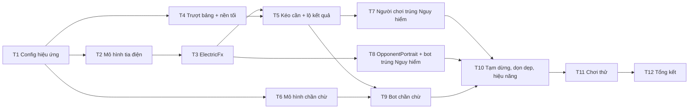

# Phase 4 – Khoảnh khắc kéo cần: danh sách task

Nhánh: `feat/pulling-lever`. Nguồn: `docs/plan.md` (Phase 4, quyết định #8), mục "Màn hình và bố cục" trong `docs/the-last-lever-thiet-ke.md`. Skill nên đọc: `lever-challenge`, `tweens`, `particles`, `cameras`, `graphics-and-shapes`, `time-and-timers`, `testing-vitest`.

**Mục tiêu của phase:** biến thử thách cần gạt thành khoảnh khắc căng nhất của game. Bảng cần trượt ra trên nền tối. Mỗi cần được kéo xuống, ngừng khoảng 1 giây rồi mới lộ kết quả. Cần Safe sáng đèn xanh, cần Nguy hiểm sáng đèn đỏ và phóng tia điện. Người chơi trúng Nguy hiểm thì cả màn hình lóe trắng và rung. Bot trúng Nguy hiểm thì hình nhân vật bị điện giật. Bot chần chừ trước mỗi cần. Không tụt khung hình.

**Những gì đã có sẵn (không làm lại):**
- `src/ui/LeverPanel.ts`: bảng 6 cần trên lớp tối (`addBackdrop(scene, 'lever')`, độ tối `LAYOUT.leverPanel.dim`), tiêu đề, bộ đếm "Đã kéo x / n" (mục đã đánh dấu trong plan), gợi ý chạm. `open()` và `close()` hiện chỉ làm mờ cả container. `reveal(lever, danger)` kéo tay cần xuống nửa đường, nháy đèn hổ phách trong `TIMING.leverReveal`, rồi tô Safe hoặc Nguy hiểm.
- `TableScene.play()` phát `challengeStarted` (câu thoại + `leverPanel.open`), `leverPulled` (`leverPanel.reveal`), `roundEnded` (`leverPanel.close`, cập nhật tỉ số, banner).
- Bot đến lượt kéo cần thì `advance()` chờ `BOT.thinkMs` (0,8–2,5 giây) rồi gọi `botMove()`. Lượt kéo cần không hiện "Đang suy nghĩ…".
- `tableRng` (hạt giống `seed + 2`) dùng cho nhịp suy nghĩ và câu thoại, nên `?seed=` tái hiện được cả nhịp chơi.
- `src/ui/anim.ts`: `tweenAsync`, `wait` (chạy theo đồng hồ của scene, nên dừng theo `scene.pause()`).
- `src/ui/textures.ts`: `glowTexture` và các texture vẽ bằng canvas. `addGlow` trong `decor.ts`.
- Màu `COLORS.safe`, `COLORS.danger`, `COLORS.shock` (xanh điện), `COLORS.amber`.
- Nhân vật hiện là hình tròn giữ chỗ vẽ thẳng trong `TableScene.drawOpponent()`, chưa có component riêng. Hình thật để Phase 5.

**Quy ước cho mọi task:**
- Lõi không đổi. Phase 4 chỉ đụng `src/ui/`, `src/scenes/`, `src/config.ts`. Lõi vẫn trả kết quả kéo cần ngay lập tức; mọi nhịp ngừng là việc của lớp hiển thị.
- Không lộ trước kết quả: hoạt ảnh trước khi lật đèn (kéo, ngừng, chần chừ) phải giống hệt nhau dù cần là Safe hay Nguy hiểm, kể cả độ dài.
- Mọi thời lượng, số lượng tia, hạt, độ rung, độ lóe nằm trong `src/config.ts`.
- Hiệu ứng ngẫu nhiên (hình tia điện, cần bot lướt qua) lấy số từ một `Rng` hiển thị có hạt giống, không dùng `Math.random`, để `?seed=` tái hiện được.
- Phần tính toán không cần Phaser (hình tia điện, chuỗi cần chần chừ) tách ra file `*Model.ts` để test trên Node, giống `actionBarModel.ts` và `talkModel.ts`.
- Mọi tween, hẹn giờ và hạt chạy theo đồng hồ của scene (`tweenAsync`, `wait`, `time.addEvent`), không dùng `setTimeout`, để dừng hoặc tắt scene là dừng luôn hiệu ứng.
- Trong lúc thử thách, nút về menu bị nền tối che và không bấm được. Đây là chủ ý (quyết định #19), đừng mở lại.
- Hiệu ứng nháy sáng: không quá 3 lần lóe mỗi giây (ngưỡng an toàn cho người nhạy cảm ánh sáng). Kiểm tra bằng test config.
- Chạy GitNexus `impact` trước khi sửa `LeverPanel`, `TableScene.play`, `TableScene.advance`, `drawOpponent`.
- Một task chỉ xong khi `npm run typecheck`, `lint`, `format:check` và `test` đều qua. Mỗi task nên gọn trong một commit.

## Thứ tự và phụ thuộc

| # | Task | Tệp chính | Phụ thuộc |
| --- | --- | --- | --- |
| T1 | Khối config cho hiệu ứng kéo cần | `src/config.ts`, `tests/config.test.ts` | – |
| T2 | Mô hình tia điện (hàm thuần) | `src/ui/lightningModel.ts` | T1 |
| T3 | Component `ElectricFx`: tia điện và tia lửa | `src/ui/ElectricFx.ts`, `src/ui/textures.ts` | T2 |
| T4 | Bảng cần trượt ra, nền tối riêng | `src/ui/LeverPanel.ts` | T1 |
| T5 | Hoạt ảnh kéo cần, nhịp ngừng, đèn Safe/Nguy hiểm | `src/ui/LeverPanel.ts` | T3, T4 |
| T6 | Mô hình chuỗi cần bot chần chừ (hàm thuần) | `src/ui/leverModel.ts` | T1 |
| T7 | Người chơi trúng Nguy hiểm: lóe trắng, rung, tia điện ra mép | `src/scenes/TableScene.ts` | T5 |
| T8 | `OpponentPortrait` và hiệu ứng bot trúng Nguy hiểm | `src/ui/OpponentPortrait.ts`, `src/scenes/TableScene.ts` | T3 |
| T9 | Bot chần chừ trước mỗi cần | `src/ui/LeverPanel.ts`, `src/scenes/TableScene.ts` | T5, T6 |
| T10 | Tạm dừng, dọn dẹp, đo khung hình | `src/scenes/TableScene.ts`, `src/ui/*` | T7, T8, T9 |
| T11 | Chơi thử | – | T10 |
| T12 | Tổng kết phase | `docs/plan.md`, skill `lever-challenge`, PR | T11 |

---

## T1 – Config hiệu ứng kéo cần

- [x] Thêm khối `LEVER_FX` vào `src/config.ts` (gom mọi số của phase ở một chỗ): (Thêm cả `bolt.fadeMs`, `sparks.gravity`, `jolt` cho cú giật của bảng, `botHit.flashAlpha`, `playerHit.boltMs`.)
  - `slide: { ms, offsetY, ease }`: bảng trượt từ dưới lên khi mở, trượt xuống khi đóng. `dimMs`: thời gian nền tối hiện ra.
  - `pull: { ms }` thay cho `TIMING.leverPull`; `suspenseMs` thay cho `TIMING.leverReveal`, đặt khoảng 1.000 (plan: "ngừng ~1 giây, cấu hình được"); `afterMs` thay cho `TIMING.afterLever`. Xoá khóa cũ trong `TIMING` khi không còn ai dùng.
  - `tremble: { px, ms }`: tay cần rung nhẹ trong lúc ngừng.
  - `bolt: { depth, jitter, branchChance, branchScale, width, glowWidth, flickerMs, ms }`: hình tia điện (T2, T3).
  - `sparks: { count, speed, lifespanMs }`: tia lửa ở cần Nguy hiểm.
  - `playerHit: { flashMs, flashAlpha, shakeMs, shakeIntensity, edgeBolts }`.
  - `botHit: { shakeMs, shakePx, flashes, flashMs, bolts }`.
  - `hesitate: { hovers: { min, max }, hoverMs, settleMs }`: số cần bot lướt qua trước khi kéo và thời gian dừng ở mỗi cần.
  - `botPullThinkMs: { min, max }`: khoảng chờ ngắn trước lượt kéo của bot, vì nhịp chần chừ (T9) đã gánh phần kịch tính. `BOT.thinkMs` chỉ còn dùng cho lượt cược.
- [x] Mở rộng `tests/config.test.ts`:
  - Mọi thời lượng > 0, `min ≤ max`.
  - `hesitate.hovers.max < LEVERS.count`.
  - Nhịp lóe an toàn: `playerHit` chỉ lóe 1 lần; `botHit.flashes` lần nháy trải trên ít nhất `flashes / 3` giây (tức `2 × flashMs ≥ 333`).
  - `bolt.depth` đủ nhỏ để số điểm mỗi tia có giới hạn (ví dụ ≤ 6, tức ≤ 65 điểm).

## T2 – Mô hình tia điện (`lightningModel.ts`)

Hàm thuần, không import Phaser.

- [x] `boltPoints(from, to, rng, opts)`: chia đôi đoạn thẳng `depth` lần, mỗi lần đẩy trung điểm lệch vuông góc một khoảng ngẫu nhiên trong `±jitter × độ dài đoạn`. Trả mảng điểm từ `from` tới `to`.
- [x] `boltBranches(points, rng, opts)`: với xác suất `branchChance` tại mỗi điểm giữa, mọc một nhánh ngắn hơn (`branchScale`) theo hướng lệch khỏi trục chính. Trả mảng các đường (mỗi đường là mảng điểm).
- [x] `edgeTargets(origin, count, rng, frame)`: `count` điểm nằm trên mép khung 1280×720, rải đều theo góc quanh `origin` có lệch ngẫu nhiên. Dùng cho tia điện tỏa ra mép màn hình (T7).
- [x] Test (`tests/ui/lightningModel.test.ts`):
  - Điểm đầu và cuối trùng đúng `from`, `to`; số điểm bằng `2^depth + 1`.
  - Mọi điểm nằm trong hành lang `jitter` quanh đoạn thẳng gốc.
  - Cùng hạt giống cho cùng hình; khác hạt giống cho hình khác.
  - `edgeTargets` nằm đúng trên mép khung và phủ đủ các hướng (không dồn một phía).

## T3 – Component `ElectricFx`

- [x] `src/ui/ElectricFx.ts`: một `Container` vẽ tia điện bằng `Graphics`. Mỗi tia vẽ hai lớp: lớp ngoài rộng, màu `COLORS.shock`, alpha thấp (giả hào quang, rẻ hơn filter blur); lớp lõi mảnh màu trắng.
  - `zap(from, to, ms): Promise<void>`: trong `ms`, cứ mỗi `flickerMs` vẽ lại một tia mới (hình đổi liên tục mới giống điện), xong thì mờ dần và xoá.
  - `burst(x, y, color)`: phun tia lửa bằng particle emitter của Phaser, dùng texture `sparkTexture` (thêm vào `textures.ts`, vẽ một lần và dùng lại).
  - Nhận `Rng` hiển thị từ scene, truyền xuống `lightningModel`.
- [x] Tạo một `Rng` hiệu ứng riêng trong `TableScene.init()` (`seed + 3`), không dùng chung `tableRng`, để thêm hay bớt hiệu ứng không làm đổi câu thoại và nhịp suy nghĩ của các hạt giống cũ.
- [x] Mọi hẹn giờ dùng `scene.time.addEvent`. Hàm `stop()` hủy hẹn giờ, dừng emitter, xoá hình; gọi khi scene tắt.

## T4 – Bảng cần trượt ra, nền tối riêng

- [x] Tách lớp tối (`addBackdrop(scene, 'lever')` và vùng chặn chạm) khỏi container bảng, để nền tối mờ dần tại chỗ còn bảng trượt lên từ `slide.offsetY` bên dưới (ease kiểu `Back.easeOut`). Nền tối vẫn ở depth dưới bảng và dưới `SpeechBubble` (110).
- [x] `open()` chạy nền tối và trượt bảng song song, resolve khi cả hai xong. `close()` làm ngược lại (trượt xuống, nền sáng dần). Giữ nguyên chữ ký `open` / `close` để `TableScene` không phải đổi.
- [x] Trong lúc trượt không nhận chạm (đã đúng vì `setAccepting(true)` chỉ gọi khi hàng đợi rảnh; kiểm tra lại).
- [x] `sync()` khi bảng chưa mở (vẽ lại từ trạng thái) không làm bảng nhảy vị trí.

## T5 – Hoạt ảnh kéo cần và lộ kết quả

- [x] Viết lại `reveal(lever, danger)` thành ba nhịp:
  1. **Kéo:** tay cần đi hết hành trình xuống đáy rãnh trong `pull.ms`, thẻ cần sáng viền hổ phách (trạng thái `pulling` đã có).
  2. **Ngừng:** đèn nháy hổ phách, tay cần rung nhẹ (`tremble`) trong `suspenseMs`. Nhịp này giống hệt nhau cho Safe và Nguy hiểm.
  3. **Lộ:** Safe thì đèn xanh bừng sáng rồi dịu lại, chữ AN TOÀN. Nguy hiểm thì đèn đỏ, `ElectricFx.zap` vài tia ngắn từ đèn xuống tay cần trong khung thẻ, `burst` tia lửa đỏ, thẻ cần rung, chữ NGUY HIỂM!.
- [x] Bộ đếm "Đã kéo x / n" cập nhật đúng lúc lộ kết quả, không phải lúc bắt đầu kéo.
- [x] Thêm `leverCenter(index)` (toạ độ đèn hoặc tay cần trong khung 1280×720) để T7 và T9 biết điểm xuất phát của hiệu ứng. (Đặt tên `leverPoint`, trả toạ độ đèn. Thêm `shown()` trả trạng thái bảng cho T9. Cả bảng giật, thay vì riêng thẻ cần, theo `LEVER_FX.jolt`.)
- [x] Bỏ comment "Phase 4 adds the electric effects" ở đầu class.

## T6 – Mô hình chuỗi cần bot chần chừ (`leverModel.ts`)

Hàm thuần, không import Phaser.

- [x] `hesitationPath(levers, target, rng, hovers)`: trả chuỗi chỉ số cần bot lướt qua, kết thúc ở `target`. Chỉ gồm cần còn `'unknown'`; không lặp lại cùng một cần hai lần liền; số bước nằm trong `hovers.min…hovers.max` nhưng không vượt số cần còn lại. Còn đúng một cần thì chuỗi chỉ có `target`.
- [x] Test (`tests/ui/leverModel.test.ts`): phần tử cuối luôn là `target`; mọi phần tử là cần chưa kéo; không có hai phần tử liền nhau trùng; độ dài nằm trong khoảng; cùng hạt giống cho cùng chuỗi.

## T7 – Người chơi trúng Nguy hiểm

- [x] Trong `TableScene.play()`, nhánh `leverPulled` với `seat === HUMAN` và `danger`: sau khi `reveal` lộ đèn đỏ, phát chuỗi:
  - `cameras.main.flash` màu trắng (`playerHit.flashMs`, `flashAlpha`).
  - `cameras.main.shake` (`shakeMs`, `shakeIntensity`).
  - `ElectricFx` vẽ `edgeBolts` tia từ cần vừa kéo tỏa ra các điểm `edgeTargets` trên mép màn hình, ở depth trên bảng cần.
- [x] Chờ hiệu ứng xong rồi mới cho hàng đợi đi tiếp tới `roundEnded`, để banner không đè lên lúc điện giật.
- [x] Sau khi rung xong, camera về đúng vị trí (không lệch khung).

## T8 – `OpponentPortrait` và bot trúng Nguy hiểm

Bảng cần và nền tối che hình nhân vật (bảng ở depth 100, nền tối phủ cả màn hình), nên hiệu ứng bot trúng điện giật phát **sau khi bảng đóng**, ngay trước banner. Trong bảng, cần Nguy hiểm của bot vẫn có đèn đỏ, tia điện và tia lửa của T5, nhưng không có lóe trắng hay rung camera. Hai bên trúng điện có cảm giác khác nhau.

- [x] Tách phần hình đại diện trong `TableScene.drawOpponent()` (quầng sáng, hình tròn, chữ cái đầu) thành `src/ui/OpponentPortrait.ts` (`Container`). Phase 5 chỉ cần thay hình tròn bằng PNG trong component này. Bảng tên và hai lá úp giữ nguyên trong `TableScene`.
- [x] `OpponentPortrait.shock(): Promise<void>`:
  - Rung container qua lại `botHit.shakePx` trong `shakeMs`.
  - Nháy màu `botHit.flashes` lần giữa `COLORS.shock` và `COLORS.danger` (tint lên hình, quầng sáng bừng lên).
  - `ElectricFx` vẽ `botHit.bolts` tia ngắn bám quanh viền hình.
  - Xong thì trả về đúng vị trí, màu và độ sáng ban đầu.
- [x] Trong nhánh `roundEnded`: nếu `result.kind === 'win'` và `winner === HUMAN` (bot vừa kéo trúng Nguy hiểm) thì `await portrait.shock()` sau `leverPanel.close()`, trước `showBanner`.
- [x] Đặt thứ tự cho nhánh `roundEnded`: đóng bảng, (hiệu ứng nhân vật), cập nhật tỉ số, banner.

## T9 – Bot chần chừ trước mỗi cần

- [x] Lượt kéo cần của bot trong `advance()` dùng `LEVER_FX.botPullThinkMs` thay cho `BOT.thinkMs`.
- [x] `LeverPanel.hesitate(path): Promise<void>`: với mỗi cần trong `path`, sáng viền thẻ cần đó, nhích tay cần xuống một chút rồi nhả (như định kéo rồi đổi ý) trong `hoverMs`. Ở cần cuối (`target`) thì dừng thêm `settleMs` rồi để `reveal` kéo thật.
- [x] Trong nhánh `leverPulled` với `seat === BOT`: tính `hesitationPath` từ trạng thái cần đang hiển thị trên bảng (trước lần kéo này) và `fxRng`, `await leverPanel.hesitate(path)`, rồi mới `reveal`. Bot đã chọn xong trong `botAct()`, nên chần chừ chỉ là diễn hoạt và không lộ gì; nhịp chần chừ cũng không được khác nhau giữa cần Safe và cần Nguy hiểm.
- [x] Gợi ý dưới bảng vẫn là "{name} đang chọn…".

## T10 – Tạm dừng, dọn dẹp, đo khung hình

- [x] Nút về menu bị nền tối che trong suốt thử thách và **giữ nguyên như vậy** (đã chốt, xem quyết định #19 trong plan), nên không thể mở popup giữa lúc kéo cần. Kiểm tra sau T4: nền tối tách riêng vẫn che và chặn chạm vào nút về menu từ lúc bảng bắt đầu trượt ra tới lúc bảng đóng hẳn, kể cả trong lúc nhân vật bị giật (T8). Ngoài lúc đó (khi cược), popup vẫn mở được như cũ.
- [x] Hiệu ứng vẫn chỉ chạy theo đồng hồ của scene (`tweenAsync`, `wait`, `time.addEvent`), để sau này nếu cho phép tạm dừng thì không phải sửa lại.
- [x] Về menu hoặc kết thúc trận giữa hiệu ứng: `ElectricFx.stop()` và hủy hẹn giờ khi scene `SHUTDOWN`, không còn lỗi console.
- [x] Ván mới (`clearRound`) không còn sót tia điện, tia lửa, tint hay độ lệch của nhân vật.
- [x] Thêm `?debug=fps`: hiện `game.loop.actualFps` ở góc màn hình (kèm số thấp nhất từ lúc thử thách gần nhất bắt đầu; gộp với bot: `?debug=bot,fps`).
- [x] Đo trong lúc tia điện ra mép màn hình và lúc nhân vật bị giật, trên máy tính có bật CPU throttling 4× trong DevTools. Nếu tụt dưới 55 fps: giảm `bolt.depth`, `sparks.count`, hoặc vẽ lại tia thưa hơn (`flickerMs`), chỉ chỉnh trong config. (Đã đo bằng Edge headless: không dùng được để kết luận, vì headless render bằng phần mềm nên ngay lúc nhàn rỗi trên bàn chơi chỉ 22–42 fps. Trong thử thách, trung vị thấp hơn lúc nhàn rỗi khoảng 15–25%. Bạn đã đo trên trình duyệt thật và xác nhận ổn, Oct 14, 2026.)

**Thử khói (Oct 14, 2026)** bằng Edge headless qua DevTools Protocol, script tự chơi `?seed=123` mức Khó và `?seed=77` mức Vừa, BEST OF 7, 17 thử thách: không có lỗi console hay exception; người chơi trúng Nguy hiểm 2 lần, bot trúng 7 lần, có cả hòa toàn Safe. Sau mỗi thử thách, camera về (0, 0) và hết rung, bảng về (0, 0) và ẩn, nhân vật về đúng chỗ, lớp trắng ẩn. Chạm thật vào nút về menu khi bảng đang mở thì không mở popup; cùng cú chạm đó lúc đang cược thì mở popup. Ảnh chụp xác nhận: bảng trượt lên, cần bot lướt qua có viền sáng, nhịp ngừng có đèn hổ phách và tay cần ở đáy rãnh, đèn xanh khi Safe, tia điện và tia lửa khi Nguy hiểm, tia điện ra mép màn hình khi người chơi trúng, nhân vật nháy màu và có tia điện quanh viền khi bot trúng. Thời gian một thử thách: 1 cần khoảng 4,3–6,9 giây, 2 cần khoảng 6,4–9,9 giây (gồm bảng mở/đóng và banner).

## T11 – Chơi thử

Bạn đã chơi tay và xác nhận ổn (Oct 14, 2026). Thử khói tự động ở T10 cũng đã đi qua cả bốn trường hợp với `?seed=123` (Khó) và `?seed=77` (Vừa).

- [x] Chơi ít nhất một trận mỗi mức khó, gặp đủ bốn trường hợp: người chơi trúng Nguy hiểm, người chơi kéo đủ toàn Safe, bot trúng Nguy hiểm, bot kéo đủ toàn Safe. Ghi lại hạt giống của từng trường hợp để thử lại bằng `?seed=`.
- [x] Cảm nhận: nhịp ngừng ~1 giây có đủ căng không, kéo 5–6 cần có bị lê thê không (tổng thời gian một thử thách dài nhất), bot chần chừ có tự nhiên không. Chỉnh trong `LEVER_FX` và ghi số cuối cùng cùng lý do vào mục chơi thử của PR. (Ước lượng: mỗi lần bot kéo mất khoảng 2,9–4,2 giây, gồm chờ 0,3–0,6 + lướt 1–3 cần × 0,42 + dừng 0,32 + kéo 0,3 + ngừng 1 + sau 0,7. Mỗi lần người chơi kéo khoảng 2 giây cộng thời gian chọn. Nếu thấy lê thê, giảm `hesitate.hovers.max` hoặc `afterMs` trước.)
- [x] Đối chiếu: không có dấu hiệu nào lộ trước kết quả (độ dài kéo, độ rung, số cần lướt qua giống nhau giữa Safe và Nguy hiểm). (Theo code: chuỗi lướt chỉ phụ thuộc trạng thái bảng và `fxRng`, không đọc `danger`; nhịp kéo và ngừng chạy trước khi `reveal` nhìn tới `danger`. Nên kiểm tra lại bằng mắt khi chơi.)
- [x] Thử `?lang=en` một trận, xem chữ trên bảng cần vừa khung. (Chữ trên bảng không đổi trong phase này; chỉ thêm khóa `debug.fps`.)

## T12 – Tổng kết phase

- [x] Đánh dấu `[x]` các mục Phase 4 trong `docs/plan.md` và các task trong file này. (Gồm cả chơi tay ở T11 và đo fps thật ở T10, bạn xác nhận Oct 14, 2026.)
- [x] Cập nhật mục "Hiển thị" trong skill `lever-challenge`: nhịp ngừng, chần chừ và hiệu ứng đọc từ `LEVER_FX`.
- [x] Cập nhật `CLAUDE.md` nếu có quy ước mới (ví dụ `?debug=fps`, `Rng` hiệu ứng `seed + 3`).
- [x] Chạy đủ `typecheck`, `lint`, `format:check`, `test`, `npm run build`.
- [x] Chạy GitNexus `detect_changes` trước khi commit.
- [x] Viết sẵn mô tả PR từ `feat/pulling-lever` vào `main` (bạn commit và mở PR).

## Để ngỏ (chưa làm trong phase này)

- **Âm thanh** cho kéo cần, tiếng Safe, tiếng điện giật: đã để sau theo plan. Thiết kế hiệu ứng sao cho sau này gắn âm thanh vào đúng ba nhịp kéo, ngừng, lộ.
- **Nhịp ngừng dài hơn ở cần quyết định** (cần cuối cùng, hoặc khi một bên đang ở điểm thắng trận): có thể làm thẳng thử thách căng hơn, nhưng plan chưa yêu cầu. Quyết định sau khi chơi thử ở T11.
- **Chạm để tua nhanh** hiệu ứng khi đã chơi nhiều ván: chưa cần.
