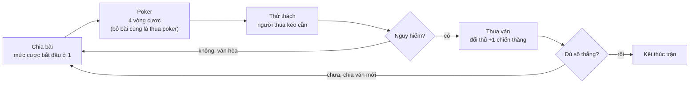

# Thiết kế game: The Last Lever

Oct 10, 2026 · @Hieu Nghia

## Tổng quan

Bản đầu tiên là game một người chơi: bạn đấu Texas Hold'em tay đôi với 1 bot, cược bằng số cần gạt, và người thua ván poker phải kéo đúng số cần đã cược. Kéo trúng cần Nguy hiểm thì đối thủ được một chiến thắng; trận đấu theo thể thức BEST OF 3, 5 hoặc 7.

- **Công nghệ:** Phaser 4, TypeScript, Vite. Chạy trên trình duyệt máy tính và điện thoại, màn hình ngang.
- **Góc nhìn:** giả góc nhìn thứ nhất bằng hình 2D. Bạn thấy mặt bàn, một đối thủ ngồi đối diện và dãy 6 cần gạt.
- **Đơn vị cược:** số cần gạt, từ 1 đến 6. Không dùng tiền thật, không có đơn vị quy đổi ra tiền.
- **Ngoài phạm vi bản đầu:** chơi online, mua trong game, bảng xếp hạng.
- **Để ngỏ cho sau này:** phần luật chơi tách khỏi Phaser, nên có thể chuyển lên server khi làm online.

## Luật chơi

Poker chỉ quyết định ai phải kéo cần và kéo bao nhiêu; chiến thắng chỉ được ghi khi người thua poker kéo trúng cần Nguy hiểm.

### Luật bạn đã chốt

**Chế độ trận đấu.** Kết quả hòa không tính là chiến thắng cho bên nào.

| Chế độ | Số chiến thắng cần đạt |
| --- | --- |
| BEST OF 3 | 2 |
| BEST OF 5 | 3 |
| BEST OF 7 | 4 |

**Hệ thống 6 cần gạt.**

- Mỗi thử thách có 6 cần gạt, mỗi cần có trạng thái ẩn là Safe hoặc Nguy hiểm.
- Số cần Safe và Nguy hiểm được chọn ngẫu nhiên trước thử thách, vị trí được xáo trộn.
- Người chơi không biết trước trạng thái của cần nào.
- Mỗi cần chỉ được kéo một lần trong một thử thách.

**Một ván đấu.**

1. Hai người chơi một ván Texas Hold'em, cược bằng số cần gạt.
2. Người thua poker phải kéo số cần gạt đã cược.
3. Kéo trúng Safe thì kéo tiếp cho đủ số. Kéo trúng Nguy hiểm thì dừng ngay, đối thủ được một chiến thắng.
4. Kéo đủ số mà toàn Safe thì ván hòa.
5. Cập nhật điểm, thiết lập lại 6 cần gạt với trạng thái mới, bắt đầu ván tiếp theo.

Trận kết thúc khi một người đạt đủ số chiến thắng của chế độ đã chọn.

### Chi tiết đã chốt thêm

Các chi tiết dưới đây đã được bạn xác nhận. Tất cả đặt trong một tệp cấu hình để chỉnh khi chơi thử.

| Chi tiết | Quy định |
| --- | --- |
| Vòng cược | 4 vòng chuẩn: trước flop, flop (3 lá), turn, river |
| Mức cược | Một mức chung cho cả hai, bắt đầu ở 1, tối đa 6 |
| Hành động | Xem bài, Tăng (+1 mức), Theo, Bỏ, Tất tay (lên thẳng 6) |
| Giới hạn tăng | Mỗi người tăng tối đa 1 lần mỗi vòng |
| Bỏ bài | Tính là thua poker, kéo số cần đã cược tính đến lúc bỏ, tối thiểu 1 cần kể cả khi bỏ ngay lượt đầu |
| Poker hòa bài | Hai bên hòa điểm, không ai kéo cần |
| Số cần Nguy hiểm | Ngẫu nhiên đều từ 1 đến 5, luôn có ít nhất 1 Safe và 1 Nguy hiểm |
| Ai chọn cần | Người thua tự chọn từng cần; bot chọn ngẫu nhiên |

Hai kỹ năng Đổi bài và Bỏ bài hèn nhát của bản trước đã được bỏ, vì luật mới không nhắc đến.

Với số cần Nguy hiểm ngẫu nhiên đều từ 1 đến 5, xác suất người thua poker bị thua ván theo số cần phải kéo:

| Số cần phải kéo | 1 | 2 | 3 | 4 | 5 | 6 |
| --- | --- | --- | --- | --- | --- | --- |
| Xác suất trúng Nguy hiểm | 50% | 73% | 85% | 92% | 97% | 100% |

Hệ quả: ván hòa chỉ thường xảy ra ở mức cược 1 và 2, còn Tất tay nghĩa là người thua poker chắc chắn thua ván.

## Luồng một ván

Mỗi ván gồm một ván poker rồi một thử thách cần gạt, và kết thúc bằng hòa hoặc một chiến thắng cho người thắng poker.



Nếu hai người hòa bài ở poker, ván hòa ngay và không ai kéo cần. Trong code, mỗi ô trên là một giá trị của `phase`: `deal`, `betting`, `challenge`, `roundResult`, `matchOver`.

## Bot

Bot quyết định bằng cách so xác suất thua ván nếu bỏ ngay với xác suất thua ván nếu đi tiếp, rồi lệch đi theo tính cách. Mỗi trận bạn gặp một trong ba tính cách, đóng vai trò như ba mức độ khó.

1. **Ước lượng tỉ lệ thắng poker:** mô phỏng ngẫu nhiên khoảng 300 ván từ bài riêng và các lá chung đã lật, đối đầu một đối thủ có bài ngẫu nhiên.
2. **Rủi ro nếu bỏ ngay:** xác suất trúng Nguy hiểm ở mức cược hiện tại, tra từ bảng trong phần Luật chơi.
3. **Rủi ro nếu đi tiếp:** (1 trừ tỉ lệ thắng poker) nhân với xác suất trúng Nguy hiểm ở mức cược dự kiến cuối ván.
4. **Chọn:** đi tiếp khi rủi ro đi tiếp thấp hơn, sau khi nhân với hệ số tính cách.

```latex
\text{theo} \iff (1 - p_{\text{thắng}}) \cdot L(m_{\text{cuối}}) \cdot k_{\text{sợ}} < L(m_{\text{hiện tại}})
```

Trong đó L(m) là xác suất trúng Nguy hiểm khi kéo m cần, tra từ bảng trong phần Luật chơi.

| Tính cách | Hệ số sợ | Tăng cược khi | Tất tay khi |
| --- | --- | --- | --- |
| Thận trọng | 1,3 | Tỉ lệ thắng trên 70% | Tỉ lệ thắng trên 90% |
| Cân bằng | 1,0 | Tỉ lệ thắng trên 60% | Tỉ lệ thắng trên 80% |
| Liều lĩnh | 0,7 | Tỉ lệ thắng trên 50%, hoặc lừa 15% số ván | Tỉ lệ thắng trên 65%, hoặc lừa 5% số ván |

Bot cũng nhìn tỉ số trận: khi đối thủ chỉ còn cách 1 chiến thắng, hệ số sợ tăng thêm 0,2; khi chính bot dẫn trước, nó giảm 0,1.

Bot không bao giờ được xem bài của bạn hay trạng thái ẩn của cần gạt. Khi phải kéo cần, bot chọn ngẫu nhiên trong các cần chưa kéo. Bot có độ trễ suy nghĩ 0,8 đến 2,5 giây và biểu cảm (bình thản, lo lắng, tự tin) đôi khi lệch với bài thật, để bạn có thứ mà đọc và bị lừa.

## Màn hình và bố cục

Game có 4 màn hình; toàn bộ thời gian chơi diễn ra ở màn Bàn chơi, khung thiết kế 1280 × 720, tự co giãn giữ tỉ lệ.

| Màn hình | Nội dung |
| --- | --- |
| Tải | Thanh tiến độ, nạp hình và âm thanh |
| Menu | Chọn BEST OF 3, 5 hoặc 7, chọn đối thủ, cách chơi, đổi ngôn ngữ Việt hoặc Anh, bật tắt âm thanh |
| Bàn chơi | Toàn bộ trận đấu |
| Kết quả | Thắng hoặc thua, tỉ số, số ván hòa, chơi lại |

Bố cục màn Bàn chơi, từ xa đến gần:

- **Trên cùng:** tỉ số trận dạng chấm tròn cho mỗi bên, ví dụ 2 chấm cho BEST OF 3, và số ván hòa.
- **Nửa trên:** nền quán rượu tối và đối thủ ngồi chính giữa, vẽ lớn để thấy rõ biểu cảm, kèm tên và hai lá bài úp.
- **Giữa:** mặt bàn vẽ theo phối cảnh hình thang, 5 ô lá chung và mức cược hiện tại hiển thị bằng 6 ô, ô đã cược sáng lên.
- **Dưới trái:** hai lá bài của bạn, lớn và ngửa.
- **Đáy:** thanh hành động gồm Xem bài, Tăng, Theo, Bỏ, Tất tay. Nút không hợp lệ bị làm mờ, nút Bỏ và Theo hiện số cần sẽ phải kéo nếu thua.

Khi vào thử thách, bảng 6 cần gạt trượt ra giữa màn hình và có bộ đếm, ví dụ đã kéo 1 trên 3. Bạn chạm vào cần muốn kéo; mỗi cần ngừng khoảng 1 giây rồi mới lộ kết quả: Safe thì đèn xanh, Nguy hiểm thì đèn đỏ kèm hiệu ứng điện giật. Đây là khoảnh khắc chính của game nên đáng đầu tư hiệu ứng nhất.

Trên điện thoại, nút bấm và cần gạt cao tối thiểu 64 px, mọi thao tác chỉ cần một chạm.

## Kiến trúc code

Code chia hai lớp: lõi luật chơi bằng TypeScript thuần không phụ thuộc Phaser, và lớp hiển thị Phaser chỉ vẽ lại những gì lõi báo ra.

```text
src/
  core/            luật chơi, không import Phaser
    cards.ts         bộ bài, xáo bài
    handEvaluator.ts xếp hạng bộ 5 lá mạnh nhất từ 7 lá
    betting.ts       mức cược, hành động hợp lệ trong ván poker
    levers.ts        tạo 6 cần gạt, kéo cần, kết quả thử thách
    match.ts         tỉ số, chế độ BEST OF, điều kiện kết thúc trận
    rules.ts         chuyển trạng thái giữa các phase
    gameState.ts     kiểu dữ liệu trạng thái
    rng.ts           số ngẫu nhiên có hạt giống
  ai/
    equity.ts        mô phỏng tỉ lệ thắng poker
    botBrain.ts      chọn hành động
    personalities.ts ba tính cách
  scenes/          BootScene, MenuScene, TableScene, ResultScene
  ui/              CardSprite, OpponentView, LeverPanel, ActionBar, ScoreBar
  i18n/            vi.ts, en.ts, hàm t()
  config.ts        mọi tham số cân bằng
```

Ba nguyên tắc:

- **Lõi là hàm thuần.** `applyAction(state, action)` trả về trạng thái mới kèm danh sách sự kiện như chia bài, lật lá, tăng cược, kéo cần, cộng điểm.
- **Scene chỉ diễn hoạt.** `TableScene` nhận danh sách sự kiện và phát lần lượt bằng tween, không tự quyết định luật.
- **Ngẫu nhiên có hạt giống.** Cùng hạt giống cho cùng ván bài, nên lỗi tái hiện được và kiểm thử ổn định.

Lõi được kiểm thử bằng Vitest, ưu tiên bộ xếp hạng bài và các chuyển trạng thái. TypeScript bật chế độ strict.

Giao diện có hai ngôn ngữ, tiếng Việt và tiếng Anh. Mọi chuỗi hiển thị nằm trong `src/i18n/vi.ts` và `src/i18n/en.ts`, tra qua hàm `t()`; ngôn ngữ đã chọn được lưu lại cho lần chơi sau.

## Tài nguyên hình ảnh và âm thanh

Bản đầu chỉ cần 1 nhân vật đối thủ với 6 trạng thái và một bảng 6 cần gạt; đây là hai thứ người chơi nhìn nhiều nhất nên cần vẽ kỹ nhất.

| Nhóm | Cần có | Bản nháp dùng gì |
| --- | --- | --- |
| Bài | 52 lá và 1 mặt sau, gộp thành một atlas | Bộ bài miễn phí bản quyền mở (ví dụ của Kenney) |
| Đối thủ | 1 nhân vật | Nhân vật 2D dạng anime |
| Bối cảnh | Nền quán rượu, mặt bàn phối cảnh, đèn treo | Hình khối màu phẳng |
| Cần gạt | Cần ở 3 trạng thái: chưa kéo, Safe, Nguy hiểm; bảng gắn 6 cần | Hình chữ nhật đổi màu |
| Giao diện | 5 nút hành động, 6 ô mức cược, chấm tỉ số, phông chữ có dấu tiếng Việt | Hình chữ nhật bo góc |
| Âm thanh | Chia bài, lật bài, kéo cần, tiếng Safe, tiếng Nguy hiểm, nền quán rượu | Chưa cần |

Khi kích hoạt, cần Nguy hiểm bật đèn đỏ và phóng tia điện giật người kéo. Nhân vật do Claude vẽ bằng SVG theo phong cách anime, rồi xuất ra PNG để nạp vào Phaser.

## Lộ trình

Sáu mốc nối tiếp nhau; game chơi được từ mốc 3, các mốc sau là hoàn thiện. Chưa có ngày cụ thể vì chưa biết quỹ thời gian của bạn.

1. **Lõi luật chơi.** Bộ bài, xếp hạng bài, cược, cần gạt, tỉ số trận, kèm kiểm thử. Xong khi chạy được một trận hoàn chỉnh bằng dòng lệnh.
2. **Bàn chơi bản nháp.** `TableScene` với hình khối, thanh hành động, bot chọn ngẫu nhiên. Xong khi bấm nút chơi hết được một trận.
3. **Bot.** Mô phỏng tỉ lệ thắng và ba tính cách. Xong khi từng cặp tính cách tự đấu 1.000 trận cho tỉ lệ thắng trong khoảng 40% đến 60%.
4. **Khoảnh khắc kéo cần.** Bảng cần gạt trượt ra, nhịp ngừng trước khi lộ kết quả.
5. **Hình ảnh thật và các màn phụ.** Nhân vật, bối cảnh, menu, hướng dẫn, kết quả.
6. **Chuẩn bị phát hành.** Thử trên điện thoại, giảm dung lượng tải, gắn SDK của cổng game.

## Rủi ro và câu hỏi cần chốt

Rủi ro lớn nhất bây giờ là cân bằng: ngay ở mức cược thấp nhất, người thua poker đã có 50% khả năng thua ván, nên poker có thể quyết định trận quá nhanh.

- **Cân bằng.** Mức 1 cho 50%, mức 3 đã là 85%. Nếu chơi thử thấy quá gắt, hướng chỉnh là thu hẹp khoảng ngẫu nhiên, ví dụ từ 1 đến 3 cần Nguy hiểm.
- **Tất tay quá mạnh.** Luôn có ít nhất 1 cần Nguy hiểm nên kéo 6 cần là chắc chắn trúng. Tất tay với bài mạnh gần như ép đối thủ bỏ bài và kéo ở mức thấp hơn.
- **Chất lượng hình anime.** Claude vẽ được nhân vật dạng vector phẳng, nét đơn giản. Mức minh họa anime chi tiết, nhiều bóng đổ thì cần họa sĩ; có thể thay hình sau mà không đổi code.
- **Chủ đề.** Poker không tiền thật và hiệu ứng điện giật kiểu hoạt hình nhẹ hơn nhiều so với súng, nhưng vẫn cần đọc quy định nội dung của từng cổng game trước mốc 5.
- **Bản quyền.** Cơ chế chơi thì được lấy cảm hứng; tên, nhân vật, hình ảnh và âm thanh của Liar's Bar thì không.
- **Bot dễ đoán.** Biểu cảm giả và các ván lừa là hai công cụ chính để chống lại.

### Đã chốt

| Câu hỏi | Quyết định |
| --- | --- |
| Tên game | The Last Lever |
| Cách cược | Một mức chung, mỗi lần tăng 1, tối đa 6 |
| Số cần Nguy hiểm | Ngẫu nhiên từ 1 đến 5 |
| Bỏ bài | Kéo số cần đã cược tính đến lúc bỏ, tối thiểu 1 cần kể cả khi bỏ ngay lượt đầu |
| Poker hòa bài | Hai bên hòa điểm, không ai kéo cần |
| Cần Nguy hiểm kích hoạt | Đèn đỏ, điện giật |
| Hình nhân vật | Claude vẽ, phong cách anime |
| Ngôn ngữ giao diện | Tiếng Việt và tiếng Anh |
